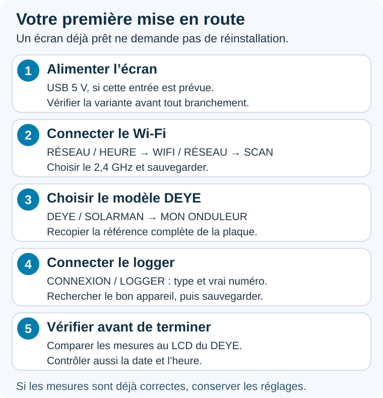

# Deye Monitor — démarrage, utilisation et mises à jour

> **Premières mesures :** [Démarrage rapide Wi-Fi + logger](docs/DEMARRAGE_RAPIDE.md) · [Fiche PDF à imprimer](docs/pdf/DEMARRAGE_RAPIDE.pdf) · [Pas à pas illustré](docs/DEMARRAGE_SIMPLE.md).

> **Documentation illustrée du 6 novembre 2026 :** [guide des menus](docs/GUIDE_UTILISATEUR_V3.md), [guide PDF](docs/pdf/GUIDE_UTILISATEUR_V3.pdf) et [mémo](docs/RECAP_UTILISATEURS_V3.md).

Deye Monitor affiche les mesures d’un onduleur DEYE sur un écran tactile GUITION ESP32-S3 480 × 480. Il fonctionne en local avec un logger compatible, sans Home Assistant ni compte cloud à renseigner dans l’écran.

## Commencer ici

**La notice est illustrée :** des captures montrent où appuyer, et des schémas expliquent l’alimentation, le réseau, les mesures et les mises à jour. Commencer par le guide si c’est votre premier écran.

- **[Première mise en route et guide utilisateur](docs/MISE_A_JOUR_ECRAN_GITHUB.md)** : alimentation, Wi-Fi, modèle, logger, premières mesures.
- **[Questions fréquentes et dépannage](docs/FAQ_ECRAN.md)** : « DEYE injoignable », connexion directe sans box, IP, GEN, alimentation, encastrement, mises à jour.
- **[DL1000B-WIFI : activer Modbus TCP](docs/GUIDE_DL1000B_MODBUS_TCP.md)** : captures pas à pas et demande à Deye pour un firmware 1.7.2 minimum.
- **[Mémo de démarrage](docs/RECAP_UTILISATEURS_V3.md)** : les étapes à garder sous la main.
- **[Téléchargements et dernière version stable](https://github.com/Chasticot/DEYE_LVGL_GUITION/releases/latest)**.

La dernière version publiée est **4.8.12**, le **9 novembre 2026**. Elle simplifie l’activation des PV5 à PV8 par une case à cocher, conserve leur dernière configuration enregistrée et corrige l’affichage des kWc. Des exemples courts sont intégrés aux réglages ; la prévision météo reste une indication moyenne. [Détails 4.8.12](docs/NOTES_4.8.12.md) · [Binaire OTA 4.8.12](https://github.com/Chasticot/DEYE_LVGL_GUITION/releases/tag/v4.8.12).

La gestion de la microSD (formatage FAT32 confirmé, retrait sécurisé et écritures groupées) et la recharge anticipée avec ou sans Tempo restent disponibles. [Guide de ces fonctions](docs/NOTES_4.8.9.md).

Sur l’écran : **Réglages > Énergie > Historique / carte SD** et **Réglages > Pilotage > Batterie / anticipation**. Sur le Web : **Énergie > Historique et carte SD** et **Pilotage > Time of Use · batterie**. Vérifier les horloges, le mode batterie SOC, le TOU actif et au moins une plage entièrement comprise dans les HC. Les notices Deye présentent un début à 00h00 ou 01h00 selon les modèles ; ce n’est pas une confirmation d’un bug universel.

Les **tableaux de bord LCD et Web restent conservés à l’identique**, ainsi que les six tuiles de réglages. La lecture directe Sossen Tuya 3.5 reste en essai : [procédure et limites 4.8.7](docs/NOTES_4.8.7.md). Les sources Hoymiles, Deye, APsystems, Enphase et Sofar, UTC/heure d’été et les autres fonctions précédentes restent disponibles. [Guide des sources solaires et de la microSD](docs/GUIDE_MICRO_SD_SOFAR.md).

Compilation et tests logiciels réussis. **Les essais physiques du formatage sur microSD et d’un cycle réel de recharge sur Deye restent à réaliser.** L’automatisme de batterie est désactivé par défaut ; vérifier son premier cycle et la restauration des consignes sur le LCD de l’onduleur.

## Prévision solaire en 4.8.0

Depuis la 4.8.5, ouvrir **Réglages > Énergie > Prévision solaire** (dans les anciennes versions : **Configuration > Prévision solaire**) ; renseigner la position et les panneaux puis activer la fonction. Sans compte ni clé API ; Internet est nécessaire pour recevoir les prévisions.

Toucher **PV auj. / PV dem.** ouvre les deux courbes. Choisir **Aujourd’hui**, **Demain** ou **Alternance** pour le bandeau ; l’alternance est réglable de **1 à 300 secondes**, avec **5 secondes par défaut**.

[Guide illustré de la prévision solaire](docs/GUIDE_PREVISION_SOLAIRE.md) · [Nouveautés et installation de la 4.8.0](docs/GUIDE_UNIFIE_4.8.0.md).

## Mettre un écran déjà installé à jour

1. Exporter ses réglages depuis la page Web de l’écran.
2. Avec Internet et une heure correcte, ouvrir **Réglages > Système > Mise à jour > Vérifier sur GitHub > Installer** depuis la 4.8.5 ; sur les versions précédentes, l’accès est dans **Configuration > Mise à jour**.
3. Sans ce menu, télécharger le fichier **`_OTA.bin`** de la release adaptée et l’envoyer depuis le formulaire OTA de **l’IP de l’écran**.
4. Garder l’alimentation jusqu’au redémarrage, puis vérifier version, modèle, logger et mesures.

Le fichier OTA ne remplace pas une première installation USB. Les archives automatiques **Source code** ne sont pas un programme d’installation. [Procédure complète et récupération USB](docs/MISE_A_JOUR_ECRAN_GITHUB.md#mettre-lécran-à-jour).

## Compatibilité et anciennes notices

Le modèle de l’onduleur **et** celui du logger comptent. LSW3/LSW5 et LSE disposent de retours de fonctionnement ; **le fonctionnement DL1000B avec notre écran est confirmé par un retour utilisateur**. Pour le DL1000B-WIFI, demander un firmware **1.7.2 minimum**, activer Modbus TCP dans **Link2** puis utiliser le port **502**. [Mode opératoire avec captures et demande à Deye](docs/GUIDE_DL1000B_MODBUS_TCP.md). [Vérifier son matériel](docs/MISE_A_JOUR_ECRAN_GITHUB.md#vérifier-la-compatibilité-avant-de-commencer).

Le [guide illustré](docs/GUIDE_UTILISATEUR_V3.md) explique **34 parcours avec 62 captures commentées**, selon les menus **4.8.10**. Les [notes 4.7.0](docs/GUIDE_UNIFIE_4.7.0.md) restent disponibles pour les anciennes versions. Les PDF ont été actualisés le **6 novembre 2026** : [guide complet illustré](docs/pdf/GUIDE_UTILISATEUR_V3.pdf) et [mémo de démarrage](docs/pdf/RECAP_UTILISATEURS_V3.pdf). Les noms de fichiers sont conservés pour les anciens liens.

Ce dépôt public distribue les **binaires OTA**, leurs empreintes SHA-256 et les guides. Les sources du firmware et leur historique restent privés. Les URL existantes des guides sont conservées pour les écrans déjà livrés.
