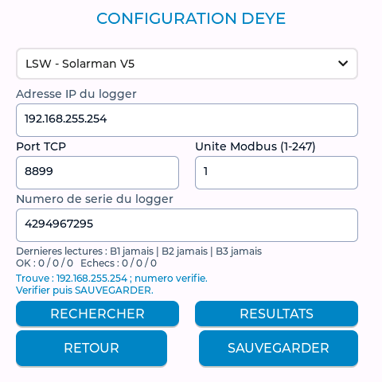
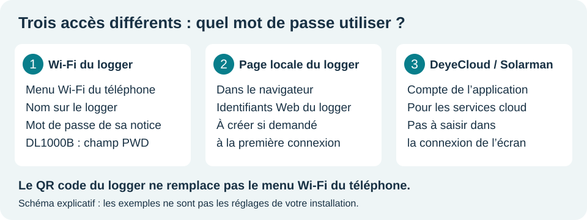
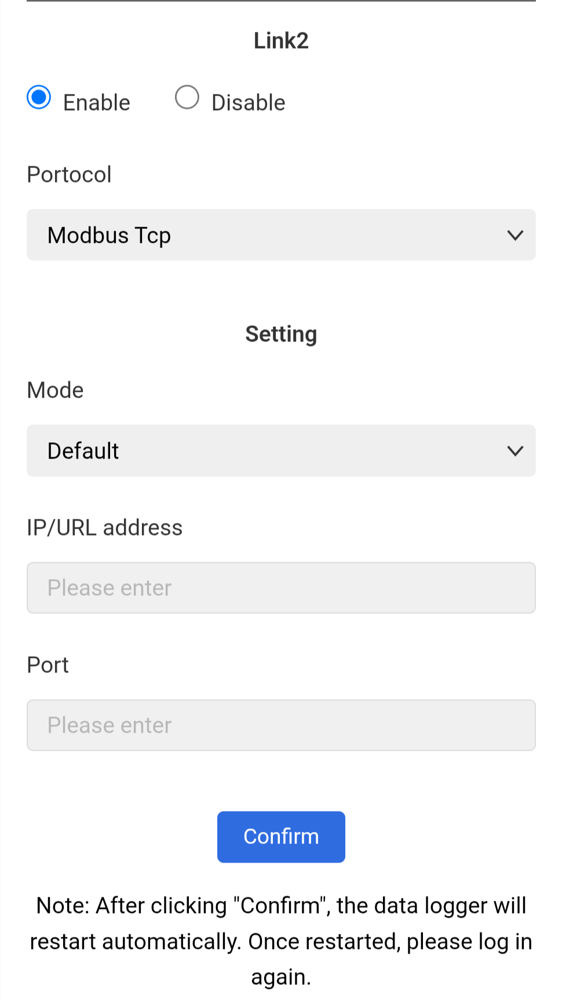
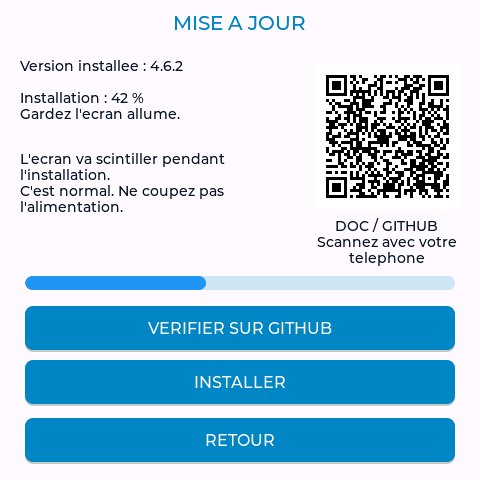
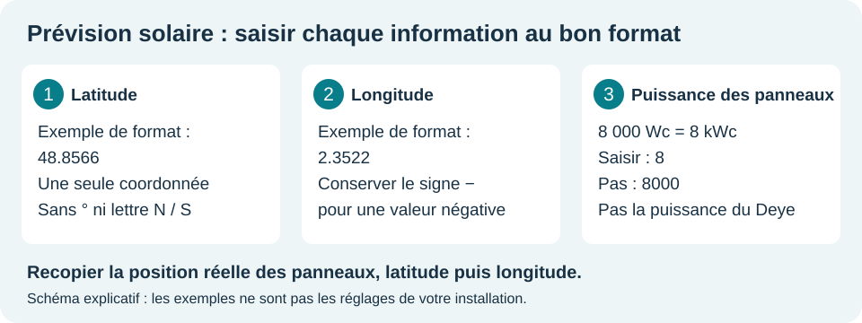
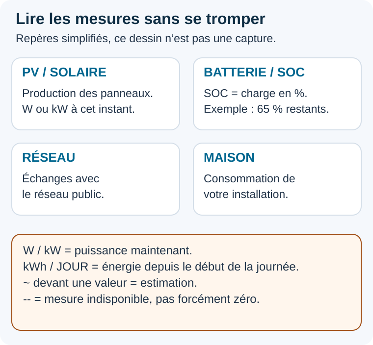
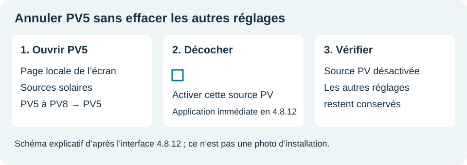

# Deye Monitor - Bien démarrer, pas à pas

**Pour commencer :** [Fiche rapide Wi-Fi + logger](DEMARRAGE_RAPIDE.md) · [Une page à imprimer](pdf/DEMARRAGE_RAPIDE.pdf).

**Édition du 13 novembre 2026.** Pour les débutants, à partir des difficultés rencontrées en assistance. Les chemins suivent les menus récents ; les anciens noms sont indiqués lorsque nécessaire.

[Version PDF](pdf/DEMARRAGE_SIMPLE.pdf) · [Tous les menus en images](GUIDE_UTILISATEUR_V3.md) · [Questions fréquentes](FAQ_ECRAN.md).

**Votre écran affiche déjà les bonnes mesures ? Vous pouvez l’utiliser.** Commencez seulement au chapitre dont vous avez besoin.

## Choisir son point de départ

| Votre situation | À faire |
| --- | --- |
| Écran reçu, aucune mesure | Chapitre 1 : Wi-Fi, modèle et logger. |
| Logger DL1000B, page inaccessible | Chapitres 2 et 3 : accès au logger et Modbus TCP. |
| Mise à jour, avec ou sans box | Chapitre 4 : choisir la bonne méthode. |
| Prévision refusée ou non conservée | Chapitre 5 : coordonnées et puissance. |
| Valeur multipliée par dix | Chapitre 6 : comparer la bonne mesure. |
| PV5 commencé par erreur | Chapitre 7 : annuler seulement cette source. |

**Les mots utiles :** le logger est le petit module de communication fixé à l’onduleur. L’IP est une adresse locale, comme un numéro de porte. OTA désigne une mise à jour par le réseau. Le LCD est l’afficheur intégré à l’onduleur.

Les captures de Deye Monitor utilisent des données simulées. Les images du logger sont identifiées dans sa notice. **Ne recopiez ni les adresses ni les numéros d’exemple.**

<!-- pagebreak -->

## 1. Faire apparaître les premières mesures

**Nouveau démarrage guidé (préparation du firmware, selon version installée) :** une fenêtre propose **1. WIFI** et **2. LOGGER**. Sauvegarder chaque page et attendre le redémarrage : le parcours reprend. **MON ONDULEUR** sert à choisir la référence ; **VOIR MESURES** ouvre le tableau de bord. Revenir par **Installation > Démarrage rapide** pour confirmer la comparaison et terminer. Le bouton attend une connexion Wi-Fi, un vrai numéro enregistré et des lectures récentes du DEYE. **PLUS TARD** reporte la configuration au prochain démarrage. Sur une version sans cette fenêtre, suivre les étapes ci-dessous.

1. Sur l’écran, ouvrir **Réglages > Réseau / Heure > Wi-Fi / Réseau**. Toucher **SCAN**, choisir le Wi-Fi de la maison en 2,4 GHz, saisir son mot de passe puis **SAUVEGARDER**. Attendre le redémarrage.
2. Ouvrir **Installation > Mon onduleur**. Choisir la référence complète de l’étiquette, suffixes compris, puis appliquer. La puissance seule ne suffit pas.
3. Ouvrir **Installation > Connexion / logger**. Choisir LSW, LSE ou DL1000B selon son module. **Remplacer 12345678, s’il apparaît, par le vrai numéro du logger.** Il ne s’agit pas du numéro de l’onduleur.
4. Saisir l’IP locale connue, le port et l’unité adaptés. Ports proposés : **LSW 8899, LSE 8899, DL1000B 502**. Si vous utilisez la recherche, vérifier l’appareil trouvé, puis sauvegarder. Un résultat trouvé n’est pas encore un réglage enregistré.

**C’est réussi quand :** les mesures arrivent, continuent de changer et correspondent à celles de l’onduleur. Vérifier au minimum batterie, consommation et production.

**DL1000B :** préparer d’abord son accès Modbus TCP, expliqué au chapitre 3. Dans les anciens menus, Installation s’appelait **DEYE / SOLARMAN**.

<!-- pagebreak -->

## 2. Ouvrir le logger depuis son téléphone

Si l’IP du logger sur la box est connue, ouvrir **http:// suivi de cette IP** dans la barre d’adresse du navigateur. Sinon, utiliser le Wi-Fi propre au logger, en restant près de lui :

1. Ouvrir les **Paramètres / Réglages du téléphone**, puis **Wi-Fi**. Sur Android, ce menu peut être dans **Connexions** ou **Réseau et Internet**. Sur iPhone : **Réglages > Wi-Fi**.
2. Choisir le réseau identifié dans la notice du logger : **D suivi de son numéro pour le DL1000B-WIFI** ; un LSW peut proposer **AP…**. Comparer avec l’étiquette. Saisir le mot de passe Wi-Fi indiqué par sa notice, le **PWD** pour le DL1000B.
3. Si le téléphone dit **« sans Internet »**, choisir de **rester connecté**. Pour cette manipulation, le téléphone communique directement avec le logger.
4. Pour le DL1000B-WIFI de la notice, ouvrir **http://10.10.100.254** dans la barre d’adresse. Pour un autre logger, vérifier l’adresse dans sa notice. Ne pas lancer une recherche Google avec l’adresse.
5. Si la page demande de créer des identifiants Web, les créer et les conserver. Sinon, utiliser les identifiants déjà configurés par le propriétaire ou l’installateur. **Ne pas supposer que le nom est admin.**

**C’est réussi quand :** la page du logger s’ouvre et permet de consulter **Device Status**. Le QR code de son étiquette n’est pas nécessaire pour rejoindre son Wi-Fi.

**Page toujours inaccessible ?** Vérifier que le téléphone est encore sur le Wi-Fi du logger. Si son basculement automatique vers les données mobiles empêche l’accès, couper temporairement les données mobiles pendant l’essai, puis les réactiver. Un mot de passe inconnu se demande à l’installateur ; ne pas réinitialiser le logger au hasard.

<!-- pagebreak -->

## 3. DL1000B : autoriser les mesures locales

1. Dans **Device Status**, relever la version du logger et son **IP STA**, c’est-à-dire son adresse sur le Wi-Fi de la maison. La préparation conseillée dans ce projet demande un firmware **1.7.2 minimum**. Si l’option locale manque, passer par la notice détaillée et le support Deye.
2. Dans **Advanced Settings**, ouvrir le lien qui propose le service local : **Link1 ou Link2**. Garder les réglages du lien cloud s’il est utilisé. Ne pas imposer Link2 lorsque Link1 fonctionne déjà.
3. Cocher **Enable**, choisir **Modbus Tcp**, puis **Default** et **Confirm**. Attendre le redémarrage. Rouvrir la page et vérifier que les choix sont conservés.
4. Remettre le téléphone sur le Wi-Fi de la maison. Sur Deye Monitor, choisir **DL1000B**, l’**IP STA**, le vrai numéro, le port **502** et la bonne unité. Sauvegarder, puis comparer les mesures à celles de l’onduleur.

**C’est réussi quand :** les mesures locales sont actualisées après redémarrage. Le fait que DeyeCloud fonctionne ne prouve pas que Modbus TCP est ouvert.

[Notice DL1000B complète](GUIDE_DL1000B_MODBUS_TCP.md) : captures, version, IP et demande d’intervention à Deye. La version du logger, celle de l’écran et celle de l’onduleur sont trois logiciels différents.

<!-- pagebreak -->

## 4. Mettre à jour avec ou sans box

**Avec Internet sur l’écran :** exporter ses réglages, puis ouvrir **Réglages > Système > Mise à jour > Vérifier sur GitHub**. Lire la version proposée, toucher **Installer** et confirmer. Dans les anciens menus : **Configuration > Mise à jour**. Attendre le redémarrage sans couper l’alimentation.

**Écran relié directement au logger, sans Internet :**

1. Avec Internet sur le téléphone ou le PC, télécharger auparavant le fichier **_OTA.bin** adapté depuis les [téléchargements officiels](https://github.com/Chasticot/DEYE_LVGL_GUITION/releases/latest). Conserver le fichier sur cet appareil.
2. Rejoindre ensuite **le même Wi-Fi de logger que l’écran**. Accepter « sans Internet ». Relever l’**IP de l’écran** dans son menu Wi-Fi.
3. Dans le navigateur, ouvrir **http:// suivi de l’IP de l’écran**. Exporter les réglages, ouvrir la mise à jour OTA, choisir le fichier téléchargé et lancer l’envoi. Garder la connexion et l’alimentation jusqu’au redémarrage.
4. Vérifier la version affichée et le retour des mesures.

**IP du logger = page du logger. IP de l’écran = page Deye Monitor et mise à jour.** Ce sont deux appareils distincts.

Une OTA compatible conserve les réglages. Un scintillement pendant l’installation est attendu. **Ne pas envoyer de ZIP ou d’image USB dans l’OTA, ni remplacer au hasard un fichier dans un ancien pack .bat.** L’USB sert à la première installation ou à une récupération avec le pack adapté.

L’écran utilise un réseau Wi-Fi à la fois. Pour avoir mesures locales et prévision Internet ensemble, relier le logger et l’écran au réseau de la maison, s’ils le permettent. Les deux réseaux isolés « logger » et « box » ne se combinent pas automatiquement.

<!-- pagebreak -->

## 5. Enregistrer la prévision solaire

Ouvrir **Réglages > Énergie > Prévision solaire**, ou **Prévision solaire** sur la page Web de l’écran. Dans les anciennes versions : **Configuration > Prévision solaire**.

1. Depuis une carte, relever la position des panneaux en **degrés décimaux**. Saisir la **latitude dans le premier champ**, la **longitude dans le second**. Garder un éventuel signe moins. Ne pas coller les deux nombres dans la même case, ni une adresse, un lien de carte ou des degrés/minutes/secondes.
2. Saisir la puissance totale **des panneaux en kWc** : **8 000 Wc = 8 kWc**, donc saisir **8**. Un point ou une virgule peut séparer les décimales ; ne pas ajouter l’unité dans le champ.
3. Renseigner l’inclinaison et l’orientation : inclinaison de 0 à 90°, orientation nord 0°, est 90°, sud 180°, ouest 270°.
4. Activer, sauvegarder et lire le message de confirmation. Si le formulaire signale une erreur, corriger les champs avant de recommencer. Après le redémarrage, rouvrir la page pour contrôler les valeurs conservées.

**C’est réussi quand :** les réglages sont conservés et le détail de la prévision indique une réception. Des champs enregistrés ne garantissent pas encore que le service a répondu : Internet et une heure correcte sont nécessaires.

Il s’agit d’une **prévision de production solaire**, pas d’une station météo avec température, pluie et vent. Le total prévu concerne la journée entière. [Notice et limites](GUIDE_PREVISION_SOLAIRE.md).

<!-- pagebreak -->

## 6. Une mesure paraît dix fois trop grande

1. Photographier au même instant Deye Monitor et l’afficheur de l’onduleur. Noter **le nom exact de la mesure** : production PV, consommation maison, réseau ou batterie.
2. Comparer les unités : **0,75 kW = 750 W**. Des kWh sont une énergie, pas une puissance instantanée.
3. Vérifier la référence complète de l’onduleur, le profil choisi, la version de l’écran et l’actualisation des données.
4. Si l’écart reste présent, envoyer ces éléments à l’assistance et exporter les réglages avant toute correction avancée.

**Exemple :** production PV de 7 500 W sur l’écran contre 750 W sur le Deye. Cela ne justifie pas de modifier **Load power** : ce champ concerne la consommation. Il faut identifier le réglage de la **production PV** et vérifier qu’il existe dans la version utilisée.

Un coefficient de **0.1** et un coefficient de **0.01** diffèrent eux-mêmes d’un facteur dix. Ne pas recopier une correction donnée à une autre installation ou à une autre mesure. Ne modifier qu’un réglage identifié, puis vérifier le résultat sur la même mesure.

**C’est résolu quand :** les deux afficheurs montrent une valeur cohérente pour le même poste et la même unité. Une valeur qui semble plausible après modification ne suffit pas à valider le profil entier.

<!-- pagebreak -->

## 7. Annuler une source PV5 commencée par erreur

**PV1 à PV4** désignent les entrées de l’onduleur principal. **PV5 à PV8** correspondent à des installations supplémentaires, par exemple une passerelle de micro-onduleurs. Ne pas créer PV5 pour faire fonctionner les panneaux déjà lus sur le Deye.

1. Exporter les réglages, puis ouvrir **Installation > Sources solaires / PV5 à PV8** et sa page Web locale. Choisir l’installation concernée.
2. **Avec la 4.8.12**, décocher **Activer cette source PV**. Le changement est immédiat, même si le brouillon est incomplet : attendre **Source PV désactivée**. Les derniers réglages enregistrés sont conservés ; les modifications non enregistrées sont abandonnées. Sur une ancienne version proposant **Désactivé** dans **Marque et connexion locale**, choisir cette option et enregistrer. Si cela reste bloqué, relever le message et la version pour l’assistance.
3. Revenir au tableau de bord et vérifier que la source n’est plus active. **Ne pas effacer toute la configuration de l’écran pour annuler seulement PV5.** Après une remise à zéro déjà effectuée, le Wi-Fi se règle directement sur le tactile, sans commande sur ordinateur.

Pour ajouter réellement une passerelle, commencer en **Afficher séparément**, attendre une **Lecture OK** et comparer à son application. Si sa production est déjà mesurée par GEN, choisir **Déjà mesurée par le port GEN** pour éviter de la compter deux fois.

[Voir la page Web complète](images/demarrage/pv5-desactive-web.png) : capture de test 4.8.12 avec données simulées.

**APsystems ECU-C :** le protocole local solaire proposé doit être vérifié sur la variante réelle ; les ECU-C de stockage ne sont pas couvertes. La présence d’une application ou d’une passerelle du même nom ne suffit pas à garantir toutes les lectures. [Guide des sources et de leurs limites](GUIDE_MICRO_SD_SOFAR.md).

<!-- pagebreak -->

## 8. Trouver la prochaine action

| Ce que vous voyez | Première action |
| --- | --- |
| Wi-Fi connecté, mais DEYE INJOIGNABLE | Vérifier type de logger, vrai numéro, IP, port et unité ; pour DL1000B, vérifier Modbus TCP. |
| La page du logger ne s’ouvre pas | Vérifier le Wi-Fi du téléphone, l’adresse locale et le préfixe http://. Reprendre le chapitre 2. |
| La page Deye Monitor ne s’ouvre pas | Utiliser l’IP actuelle de l’écran et le même réseau local, pas l’IP du logger. |
| Prévision non enregistrée | Reprendre latitude, longitude et kWc ; lire le message du formulaire. |
| Prévision absente mais mesures présentes | Vérifier Internet, l’heure et l’état de réception ; un Wi-Fi de logger isolé peut lire les mesures sans Internet. |
| Écran noir à heure fixe | Toucher pour réveiller puis vérifier Écran > Veille horaire et l’heure. |
| Modèle absent ou variante inconnue | Fournir sa référence complète ; ne pas choisir au hasard une puissance identique. |

## Demander de l’aide en un seul message

Copier cette liste et la compléter :

- **Version de l’écran :** …
- **Référence complète de l’onduleur :** …
- **Modèle du logger et version si connue :** …
- **Réseau :** Wi-Fi maison / direct logger / Ethernet / répéteur.
- **Problème exact et depuis quand :** …
- **Dernière action réalisée et résultat :** …
- **Photos :** page du réglage concerné ; pour une mesure, les deux afficheurs au même instant.

Envoyer les photos et diagnostics en privé à l’assistance. Masquer les mots de passe et QR codes d’accès ; un numéro complet d’appareil n’est utile que si l’assistance le demande. Garder aussi les exports de réglages privés.

[FAQ complète](FAQ_ECRAN.md) · [Guide des menus](GUIDE_UTILISATEUR_V3.md) · [Téléchargements](https://github.com/Chasticot/DEYE_LVGL_GUITION/releases/latest).
