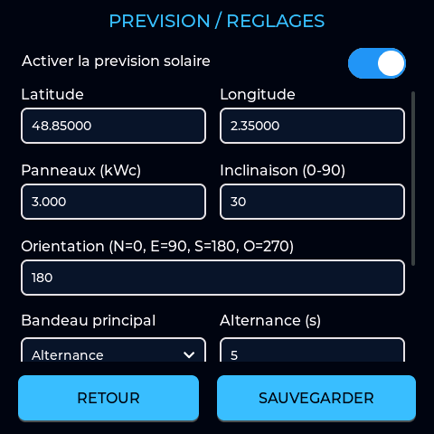
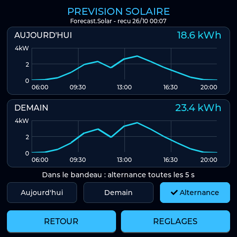
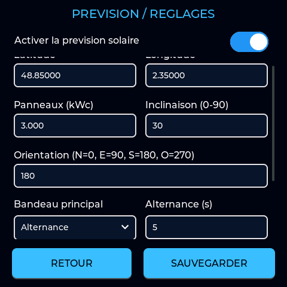

# Prévision solaire — Deye Monitor 4.8.0

[Guide complet en PDF, avec cette notice solaire](pdf/GUIDE_UTILISATEUR_V3.pdf).

[Guide utilisateur](MISE_A_JOUR_ECRAN_GITHUB.md) · [Nouveautés 4.8.0](GUIDE_UNIFIE_4.8.0.md).

**Édition du 26 octobre 2026.** Les captures ci-dessous sont des aperçus de développement : leurs coordonnées, dates et productions sont des exemples, à remplacer par les informations de votre installation.

## Mise en route

Ouvrir **Configuration > Prévision solaire** sur l'écran, ou le lien
**Prévision solaire** sur sa page Web. La page Web dédiée est `/solar`.

1. Renseigner la latitude et la longitude des panneaux, obtenues depuis une carte.
2. Indiquer leur puissance totale en **kWc** : 3000 Wc = 3 kWc.
   Utiliser la puissance des panneaux, pas celle de l'onduleur.
3. Saisir l'inclinaison : 0° à plat, 90° à la verticale.
4. Saisir l'orientation : nord 0°, est 90°, sud 180°, ouest 270°.
5. Activer la prévision, sauvegarder et attendre le redémarrage.

Les virgules et les points sont acceptés pour les décimales. Cette première
intégration représente un groupe de panneaux de même orientation et inclinaison.
Elle ne modélise pas séparément plusieurs pans de toiture ou les ombres locales.
Le fuseau horaire réglé dans l'écran doit correspondre au lieu de l'installation.

**Les coordonnées et 3 kWc de cette image sont des exemples.** Ne pas les recopier pour une autre installation.

## Lecture

Un indicateur **PV auj.** ou **PV dem.** apparaît entre l'heure et les paramètres.
Il affiche les kWh prévus pour **la journée entière**, pas la production restante.
Un appui ouvre les **deux courbes**, aujourd'hui au-dessus et demain en dessous.
Elles montrent la puissance prévue en kW au fil des heures, avec une échelle
commune pour les comparer. Le total en kWh figure au-dessus de chaque courbe.
L'état du service et la dernière réception apparaissent sous le titre. Les
mesures de l'onduleur restent affichées dans leur tuile habituelle.

Sous les courbes, choisir **Aujourd'hui**, **Demain** ou **Alternance** pour
le bandeau. Ce choix est enregistré et appliqué immédiatement, sans redémarrage.
Les deux courbes restent visibles, quel que soit le choix du bandeau.

En mode Alternance, le bandeau passe de **PV auj.** à **PV dem.** toutes les
**5 secondes par défaut**. Pour changer cette durée : ouvrir **Réglages**,
faire défiler jusqu'à **Bandeau principal**, choisir **Alternance**, régler
**Alternance (s)** puis sauvegarder. La durée est réglable de **1 à 300 secondes**.
Le même réglage est disponible sur la page Web, dans **Bandeau de l'écran**,
avec application immédiate. Le réglage initial reste Aujourd'hui pour conserver
l'affichage des écrans déjà configurés.

La durée se modifie lorsque le mode Alternance est choisi. Les deux autres modes conservent une seule journée dans le bandeau.

L'indicateur est masqué par défaut et lorsque la fonction est désactivée.
Les cinq réglages sont accessibles ensemble sur la page tactile dédiée ;
les options du bandeau se trouvent plus bas. Le clavier numérique s'ouvre
uniquement pendant la saisie.

## Service et connexion

La source est l'[API publique Forecast.Solar](https://forecast.solar/), sans
compte, abonnement ni clé API. Une connexion Internet et une date correcte sont
nécessaires. Un écran connecté uniquement à l'AP isolé d'un logger ne peut pas
récupérer la prévision sans accès Internet.

L'activation autorise l'envoi de la position, de l'inclinaison, de l'orientation
et de la puissance à Forecast.Solar. Ces informations servent uniquement à la
demande de prévision ; aucun identifiant d'onduleur ni de licence n'est envoyé.
La connexion HTTPS vérifie le certificat du service.

L'écran effectue au plus une tentative par heure, y compris si le service
échoue ou limite les demandes. La requête s'exécute en arrière-plan ; aucune
nouvelle requête n'est lancée pendant la mise à jour OTA. Une réception
réussie reste utilisable six heures et conserve ses dates : à minuit, la
prévision de demain peut devenir celle d'aujourd'hui. Une journée absente,
une valeur trop ancienne ou une date incohérente donne `--`, jamais zéro par
défaut. Une production prévue réellement nulle est bien affichée `0.0 kWh`.
Les courbes proviennent des points horaires renvoyés par le service ; elles
ne sont jamais inventées à partir du total journalier. Une courbe absente ou
trop ancienne porte la mention **Courbe indisponible**.
La page de détail explique les coupures et erreurs ; il n'y a pas de bouton
de rafraîchissement qui pourrait épuiser le quota du service.

Les réglages sont stockés séparément et conservés après une mise à jour OTA.
Ils figurent aussi dans l'export/import JSON. Un ancien export sans rubrique
solaire conserve les réglages solaires présents. La dernière prévision reçue
reste en mémoire vive : après redémarrage, attendre une nouvelle réception.
Le choix du bandeau et sa durée sont enregistrés séparément des caractéristiques
de l'installation. Leur ajout conserve les réglages solaires précédents.
L'alternance ne déclenche ni nouvelle requête Internet ni écriture en mémoire
à chaque changement. Un ancien export sans ces options conserve le choix présent.

## Vérifications et précision

La compilation, les tests logiciels et les aperçus de l’interface ont été vérifiés. Une réponse réelle du service avec les deux journées et leurs points horaires a été contrôlée le 26 octobre 2026. La précision de l’estimation et le fonctionnement sur votre matériel restent à vérifier sur l’installation réelle.
