# Deye Monitor - Guide utilisateur illustré

**Édition du 6 novembre 2026 - Menus de référence 4.8.10.**

Mettre en route l’écran, comprendre les mesures et retrouver chaque réglage avec des captures commentées. Les noms V3 des fichiers sont conservés pour les liens existants.

[Guide en PDF](pdf/GUIDE_UTILISATEUR_V3.pdf) · [Mémo de démarrage](RECAP_UTILISATEURS_V3.md) · [Questions fréquentes](FAQ_ECRAN.md).

**Les illustrations sont des captures de l’interface LVGL avec des données simulées, pas des photos prises sur une installation réelle.** Les adresses, numéros, dates, consignes et versions affichés sont des exemples. Utiliser les informations de votre propre installation. Certains écrans de fonctions communes proviennent de versions antérieures ; les légendes signalent les différences utiles.

Les menus visibles dépendent de la version installée, du modèle et de la borne choisis. Les fonctions de la préparation 4.8.10 ont été contrôlées en logiciel ; le formatage physique de la carte et un cycle réel de recharge anticipée restent à vérifier. Une consigne relue ne prouve pas un courant réel de charge.

La préparation 5.0.0 et son activation commerciale sont distinctes de ce parcours 4.8.10. Une version affichée dans une capture ne signifie pas qu’elle est publiée.

## Démarrer sans se perdre

L’écran doit disposer de l’alimentation prévue par sa notice. Il n’a pas de batterie intégrée. Avant une première installation USB, utiliser le pack adapté à la carte et au partitionnement ; un écran qui fonctionne se met normalement à jour par OTA.

1. Si les mesures sont déjà correctes, utiliser l’écran directement : aucune réinstallation n’est nécessaire.
2. Pour une première connexion : Wi-Fi, choix de l’onduleur, connexion au logger, contrôle des mesures.
3. Ajouter ensuite les sources, la prévision ou la borne réellement présentes. Activer les automatismes après vérification.

**Deux IP à distinguer :** l’IP du logger relie l’écran à l’onduleur ; l’IP de l’écran ouvre Deye Monitor sur un téléphone. Le téléphone et l’écran doivent pouvoir communiquer sur le même réseau local.

**Sans box :** une connexion directe au point d’accès d’un logger compatible reste possible. Rejoindre ce réseau avec l’écran puis le téléphone et conserver la connexion même si elle indique « sans Internet ». L’IP AP souvent rencontrée sur LSW, 10.10.100.254, n’est pas l’IP à recopier dans une installation reliée à la box. Les mesures locales peuvent fonctionner sans cloud ; l’heure manuelle est alors utile. Voir le [parcours réseau détaillé](MISE_A_JOUR_ECRAN_GITHUB.md#connexion-directe-au-logger-sans-box).

<!-- pagebreak -->

## Sommaire des menus

- [1. Se repérer dans les réglages](#1-se-repérer-dans-les-réglages)
- [2. Ouvrir les réglages de l’installation](#2-ouvrir-les-réglages-de-linstallation)
- [3. Comprendre le choix du modèle](#3-comprendre-le-choix-du-modèle)
- [4. Confirmer un changement de modèle](#4-confirmer-un-changement-de-modèle)
- [5. Relier un logger LSW ou LSE](#5-relier-un-logger-lsw-ou-lse)
- [6. Configurer un DL1000B](#6-configurer-un-dl1000b)
- [7. Choisir une IP et comprendre la reconnexion](#7-choisir-une-ip-et-comprendre-la-reconnexion)
- [8. Régler les voies PV et le port GEN](#8-régler-les-voies-pv-et-le-port-gen)
- [9. Ajouter des sources PV5 à PV8](#9-ajouter-des-sources-pv5-à-pv8)
- [10. Lire le détail de la production](#10-lire-le-détail-de-la-production)
- [11. Ouvrir les fonctions Énergie](#11-ouvrir-les-fonctions-énergie)
- [12. Configurer la prévision solaire](#12-configurer-la-prévision-solaire)
- [13. Afficher les courbes et l’alternance](#13-afficher-les-courbes-et-lalternance)
- [14. Gérer la carte microSD](#14-gérer-la-carte-microsd)
- [15. Comprendre le formatage de la carte](#15-comprendre-le-formatage-de-la-carte)
- [16. Choisir une fonction de pilotage](#16-choisir-une-fonction-de-pilotage)
- [17. Régler les tarifs et les heures creuses](#17-régler-les-tarifs-et-les-heures-creuses)
- [18. Choisir la borne de recharge](#18-choisir-la-borne-de-recharge)
- [19. Utiliser la recharge Deye LoRa](#19-utiliser-la-recharge-deye-lora)
- [20. Relier et commander une Vetronic WB01](#20-relier-et-commander-une-vetronic-wb01)
- [21. Reconnaître une borne hors ligne](#21-reconnaître-une-borne-hors-ligne)
- [22. Lire et modifier le Time of Use](#22-lire-et-modifier-le-time-of-use)
- [23. Confirmer les jours et le brouillon TOU](#23-confirmer-les-jours-et-le-brouillon-tou)
- [24. Préparer la batterie de la maison](#24-préparer-la-batterie-de-la-maison)
- [25. Vérifier les trois seuils solaires](#25-vérifier-les-trois-seuils-solaires)
- [26. Utiliser l’exemple Tempo corrigé](#26-utiliser-lexemple-tempo-corrigé)
- [27. Régler le relais intégré](#27-régler-le-relais-intégré)
- [28. Connecter le Wi-Fi et ouvrir le Web](#28-connecter-le-wi-fi-et-ouvrir-le-web)
- [29. Régler la date, l’heure et le fuseau](#29-régler-la-date-lheure-et-le-fuseau)
- [30. Choisir le thème et la veille](#30-choisir-le-thème-et-la-veille)
- [31. Utiliser le clavier et les pages longues](#31-utiliser-le-clavier-et-les-pages-longues)
- [32. Sauvegarder et diagnostiquer](#32-sauvegarder-et-diagnostiquer)
- [33. Mettre à jour le logiciel de l’écran](#33-mettre-à-jour-le-logiciel-de-lécran)
- [34. Choisir le bon fichier et retrouver de l’aide](#34-choisir-le-bon-fichier-et-retrouver-de-laide)

<!-- pagebreak -->

## 1. Se repérer dans les réglages

**Chemin :** Tableau de bord > bouton de réglages.

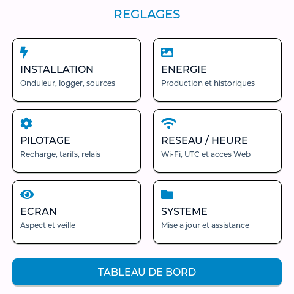
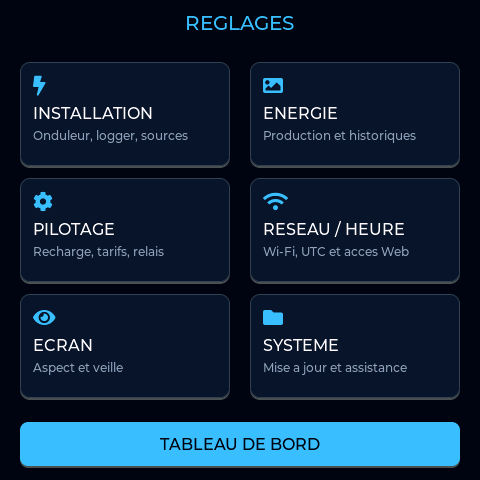

1. **Installation** : onduleur, logger et sources supplémentaires. **Énergie** : production, prévision et historique.
2. **Pilotage** : borne, tarifs, batterie et relais. **Réseau / Heure** : Wi-Fi, date et accès Web.
3. **Écran** : luminosité et veille. **Système** : mise à jour, sauvegarde, diagnostic et réglages avancés.

**À vérifier :** Sur les anciennes versions, ces accès peuvent encore porter les noms DEYE / SOLARMAN et AFFICHAGE. Les chemins de ce guide suivent la préparation 4.8.10.

<!-- pagebreak -->

## 2. Ouvrir les réglages de l’installation

**Chemin :** Réglages > Installation.

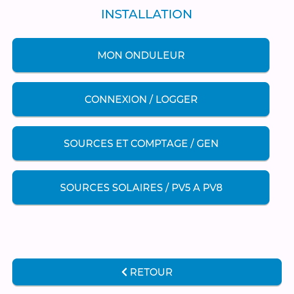
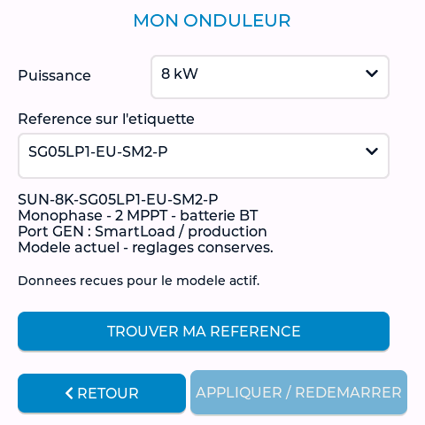

1. Commencer par **MON ONDULEUR** : relever la puissance et la référence complète sur la plaque, suffixes compris.
2. Choisir la puissance, puis la référence. Lire le récapitulatif avant **APPLIQUER / REDÉMARRER**.
3. Après redémarrage, ouvrir **CONNEXION / LOGGER**. Configurer les sources supplémentaires une fois les mesures principales correctes.

**À vérifier :** Une même puissance ne garantit pas le même protocole. Si la référence manque, faire confirmer le profil plutôt que choisir au hasard.

<!-- pagebreak -->

## 3. Comprendre le choix du modèle

**Chemin :** Réglages > Installation > Mon onduleur.

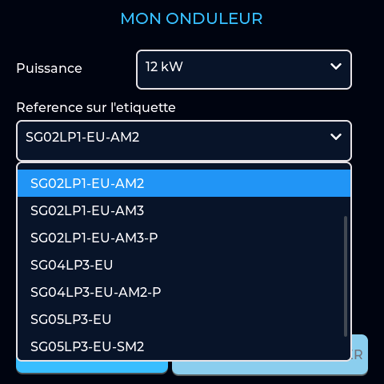
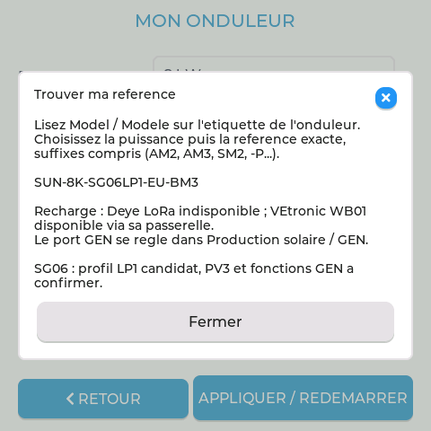

1. Dérouler la liste et rechercher la référence exacte. Le nombre de voies PV et les fonctions disponibles dépendent de ce choix.
2. Utiliser l’aide si les suffixes de la plaque sont difficiles à interpréter.
3. Un bouton grisé peut indiquer que le modèle choisi est déjà actif ou indisponible. Comparer ensuite SOC, tension et puissances au LCD du Deye.

**À vérifier :** Les noms, valeurs et références visibles sur les captures servent d’exemples ; ils ne décrivent pas votre installation.

<!-- pagebreak -->

## 4. Confirmer un changement de modèle

**Chemin :** Réglages > Installation > Mon onduleur.

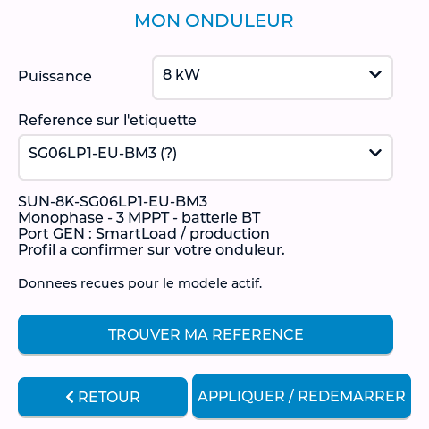
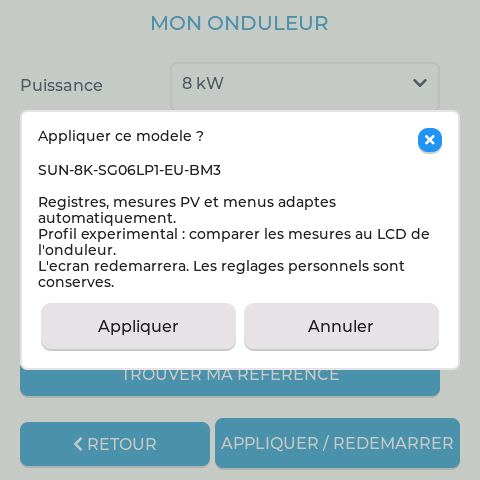

1. Lire l’avertissement quand un profil est expérimental. La présence dans la liste ne valide pas toutes les fonctions du matériel.
2. Contrôler la puissance, la référence et les suffixes dans la confirmation.
3. Après application, laisser redémarrer puis vérifier les premières mesures avant toute commande.

**À vérifier :** Ne modifier ni coefficient ni registre pour masquer une erreur de modèle. Les essais matériels dépendent de la famille d’onduleur.

<!-- pagebreak -->

## 5. Relier un logger LSW ou LSE

**Chemin :** Réglages > Installation > Connexion / logger.

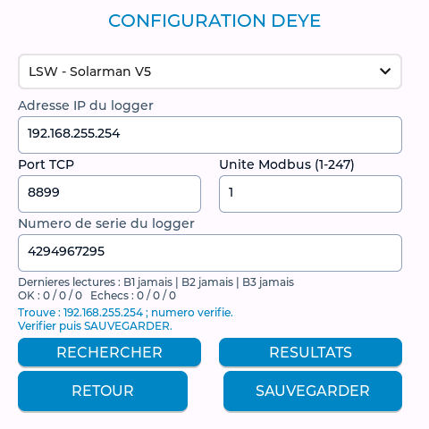
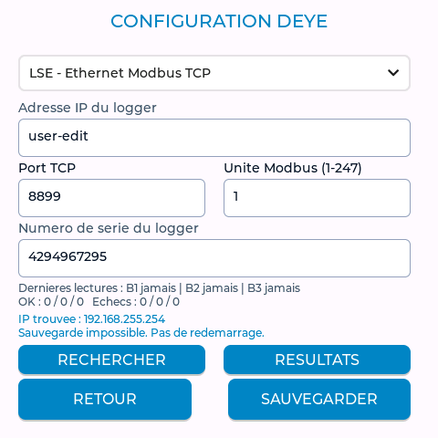

1. Choisir le type de logger réellement installé. Renseigner son **IP locale**, son numéro de série et l’unité Modbus de l’onduleur.
2. Les ports proposés sont **8899 pour LSW**, **8899 pour LSE** et **502 pour DL1000B**. Conserver un autre port si votre installation l’exige.
3. Toucher **RECHERCHER**, vérifier le résultat, puis **SAUVEGARDER**. Attendre le redémarrage et comparer les mesures au LCD.

**À vérifier :** L’IP du logger sert aux lectures. L’IP de l’écran sert à ouvrir Deye Monitor sur le téléphone. Les numéros et adresses des captures sont fictifs ; ne pas les recopier.

<!-- pagebreak -->

## 6. Configurer un DL1000B

**Chemin :** Réglages > Installation > Connexion / logger.

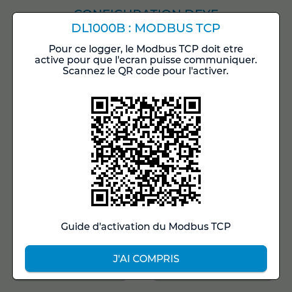
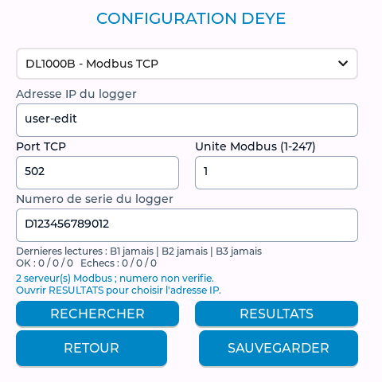

1. Suivre d’abord le [guide illustré DL1000B](GUIDE_DL1000B_MODBUS_TCP.md) pour le firmware du logger et l’activation **Link2 / Modbus TCP**.
2. Choisir **DL1000B - Modbus TCP**, renseigner l’IP, le vrai numéro, le port et l’unité.
3. Vérifier une lecture locale. La présence de données dans DeyeCloud ne suffit pas à prouver que le port local est activé.

**À vérifier :** Une réponse Modbus TCP ne vérifie pas automatiquement le numéro du logger. Identifier l’appareil avant de retenir une IP proposée.

<!-- pagebreak -->

## 7. Choisir une IP et comprendre la reconnexion

**Chemin :** Réglages > Installation > Connexion / logger > Résultats.

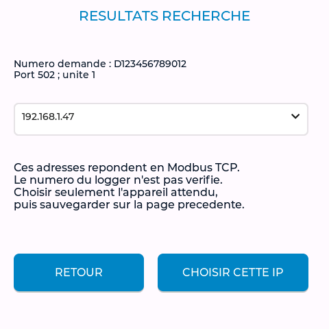
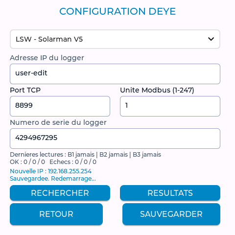

1. Si **numéro non vérifié** apparaît, ouvrir **RESULTATS**, identifier l’appareil puis toucher **CHOISIR CETTE IP**.
2. Revenir au formulaire et **SAUVEGARDER**. Une sélection dans la liste ne remplace pas l’enregistrement.
3. En LSW, le vrai numéro enregistré permet la récupération automatique d’une nouvelle IP après une perte durable. Pour LSE/DL1000B, contrôler manuellement l’IP, le port et l’unité.

**À vérifier :** Une réservation DHCP dans la box aide à conserver la même IP. Une recherche peut suspendre temporairement les lectures, sans prouver une panne de l’onduleur.

<!-- pagebreak -->

## 8. Régler les voies PV et le port GEN

**Chemin :** Réglages > Installation > Sources et comptage / GEN.

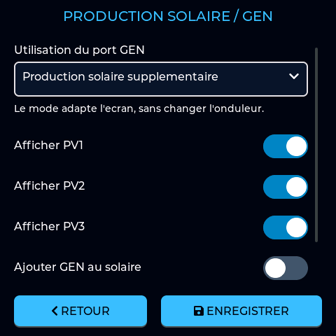
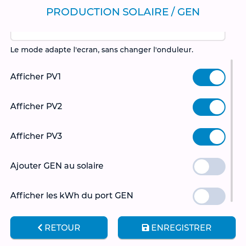

1. Choisir l’usage réel : **Automatique**, **Port non utilisé**, **SmartLoad**, **Production solaire supplémentaire** ou **Groupe électrogène**.
2. Activer les voies PV utiles. Pour du solaire sur GEN, ajouter GEN au total uniquement si cette énergie n’est pas déjà comptée.
3. Faire défiler pour les options du bas, puis **ENREGISTRER**. Les kWh GEN dépendent du profil ; une énergie estimée est repérée par **~** sur les versions qui la proposent.

**À vérifier :** Ce menu adapte l’affichage ; il ne change pas le mode électrique du port de l’onduleur. Le groupe électrogène reste exclu du total solaire.

<!-- pagebreak -->

## 9. Ajouter des sources PV5 à PV8

**Chemin :** Réglages > Installation > Sources solaires / PV5 à PV8.

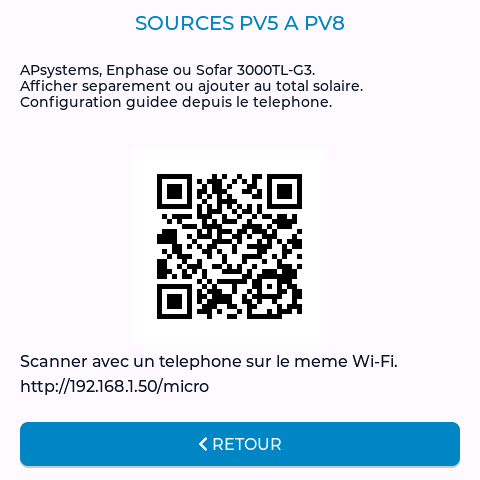
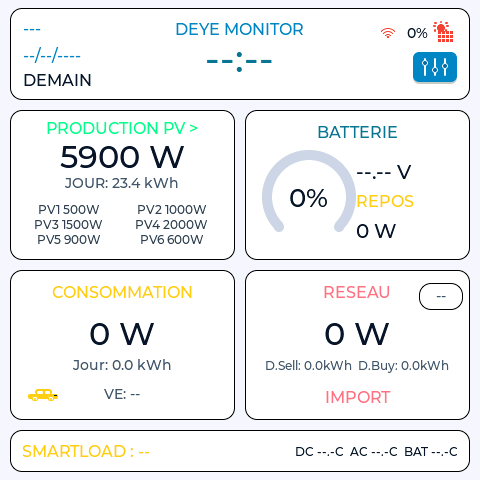

1. Connecter le téléphone et l’écran au même réseau. Scanner le QR code ou saisir l’adresse indiquée sur votre écran.
2. Choisir une installation libre, un nom, la marque et la connexion locale. Les quatre installations correspondent à **PV5, PV6, PV7 et PV8**.
3. Enregistrer d’abord en **Afficher séparément** et attendre **Lecture OK**. Comparer avec l’application du matériel avant tout ajout au total.

**À vérifier :** Choisir **Déjà mesurée par le port GEN** si GEN compte déjà cette production. Le guide [sources et historique](GUIDE_MICRO_SD_SOFAR.md) détaille les profils et leurs limites.

<!-- pagebreak -->

## 10. Lire le détail de la production

**Chemin :** Réglages > Énergie > Production par source, ou tableau de bord > PRODUCTION PV.

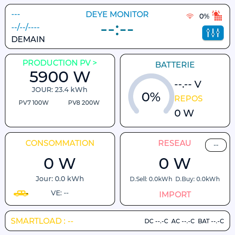
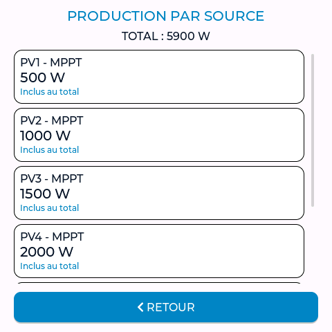

1. Ouvrir le détail pour voir toutes les sources au lieu d’attendre leur alternance sur le tableau de bord.
2. Faire défiler jusqu’en bas. Une source peut être visible sans être ajoutée au total ; lire son indication de comptage.
3. **0 W** est une mesure reçue à zéro ; **-- W** signale une mesure absente ou trop ancienne. Un total partiel ne doit pas être pris pour la production complète.

**À vérifier :** PV1 à PV4 appartiennent à l’onduleur principal. Une passerelle PV5 à PV8 représente toute sa production, pas nécessairement un seul panneau.

<!-- pagebreak -->

## 11. Ouvrir les fonctions Énergie

**Chemin :** Réglages > Énergie.

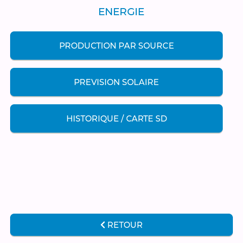
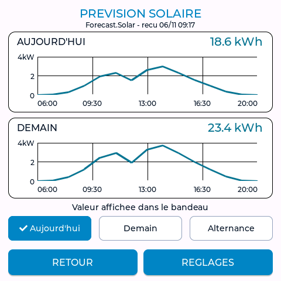

1. **PRODUCTION PAR SOURCE** explique les puissances réellement mesurées.
2. **PRÉVISION SOLAIRE** affiche une estimation et donne accès aux réglages de l’installation.
3. **HISTORIQUE / CARTE SD** permet de revoir les mesures et de gérer leur conservation.

**À vérifier :** Une prévision est une estimation, distincte des mesures de l’onduleur. Les écrans de démonstration ne prédisent pas votre production.

<!-- pagebreak -->

## 12. Configurer la prévision solaire

**Chemin :** Réglages > Énergie > Prévision solaire > Réglages.

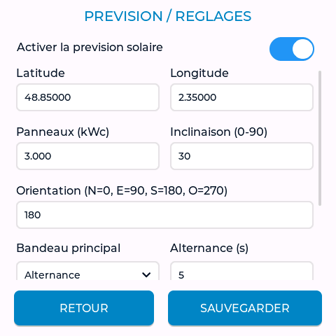
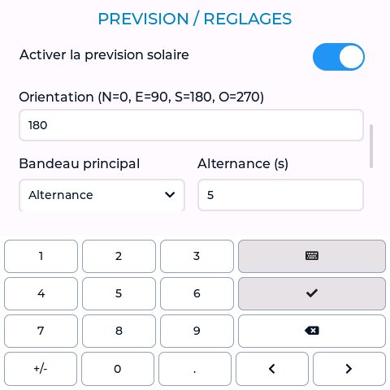

1. Renseigner la position, la puissance des panneaux et leur orientation selon l’installation réelle.
2. Respecter les unités et le sens des angles indiqués dans le formulaire. Utiliser le [guide de prévision](GUIDE_PREVISION_SOLAIRE.md) pour les limites et les conventions.
3. Enregistrer, attendre une actualisation puis vérifier la date et le résultat. Contrôler Internet et l’heure si les données restent absentes.

**À vérifier :** La prévision seule n’envoie aucune commande. L’anticipation batterie est une option distincte, désactivée par défaut.

<!-- pagebreak -->

## 13. Afficher les courbes et l’alternance

**Chemin :** Prévision solaire > Réglages d’affichage.

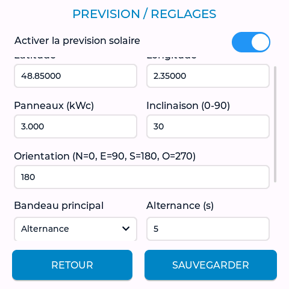
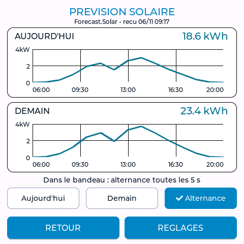

1. Choisir le bandeau et l’alternance souhaités dans les réglages dédiés.
2. Revenir au tableau de bord et laisser passer le délai choisi pour voir le changement de page.
3. Si le résultat manque, vérifier d’abord les données de l’installation et la dernière actualisation.

**À vérifier :** Les courbes de prévision et de mesure n’ont pas le même sens. Une interruption de mesure reste une donnée manquante, pas une production nulle.

<!-- pagebreak -->

## 14. Gérer la carte microSD

**Chemin :** Réglages > Énergie > Historique / carte SD.

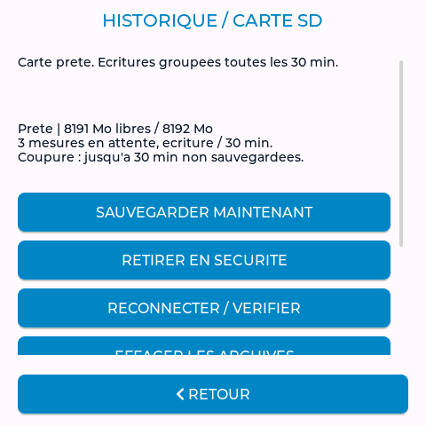
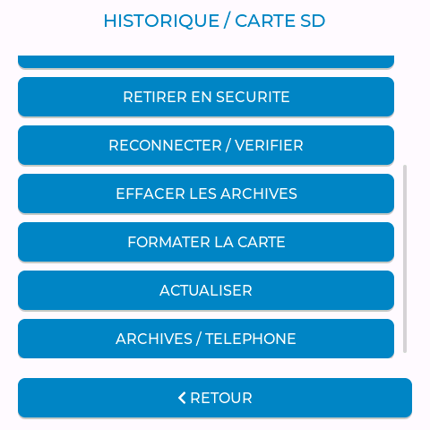

1. Vérifier l’état de la carte et son espace libre. Pour consulter une journée ou télécharger son CSV, utiliser l’accès Web de l’historique.
2. **SAUVEGARDER MAINTENANT** écrit les mesures en attente. **RETIRER EN SÉCURITÉ** ferme les fichiers : attendre la confirmation avant de retirer la carte.
3. Après réinsertion, utiliser **RECONNECTER / VÉRIFIER**. La durée de conservation et l’archivage se règlent depuis le Web.

**À vérifier :** Depuis 4.8.9, les mesures prises toutes les cinq minutes sont écrites par groupes, environ toutes les trente minutes. Une coupure peut perdre les mesures encore en attente ; sans carte, les dernières 24 h restent en mémoire vive.

<!-- pagebreak -->

## 15. Comprendre le formatage de la carte

**Chemin :** Historique / carte SD > Formater la carte.

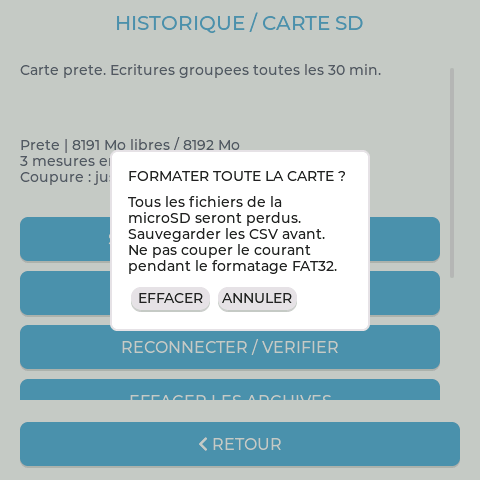
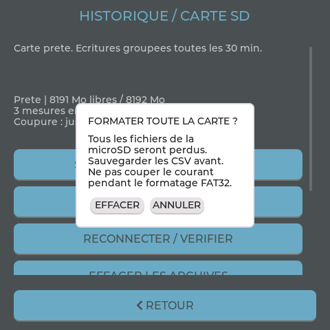

1. Télécharger les archives utiles avant de demander un formatage. Une carte FAT32 de 4 à 32 Go est le format conseillé par le guide de cette version.
2. **FORMATER LA CARTE** efface tous ses fichiers, y compris ceux d’autres appareils. **ANNULER** quitte la confirmation sans lancer l’opération.
3. Si l’opération est confirmée, laisser la carte et l’alimentation en place jusqu’au résultat. **EFFACER LES ARCHIVES** est une autre action : elle vise seulement les CSV datés de deye-history.

**À vérifier :** Aucun formatage n’est automatique. Les captures montrent une confirmation simulée ; l’essai physique du formatage reste à valider pour cette préparation.

<!-- pagebreak -->

## 16. Choisir une fonction de pilotage

**Chemin :** Réglages > Pilotage.

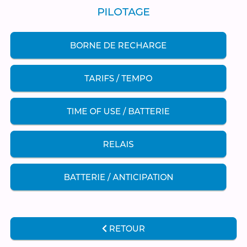
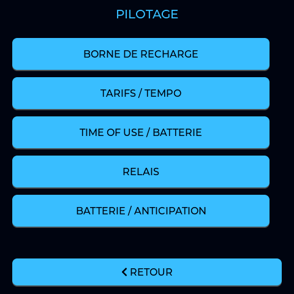

1. **BORNE DE RECHARGE** concerne la voiture. **BATTERIE / ANTICIPATION** concerne la batterie de la maison.
2. **TARIFS / TEMPO** définit les heures creuses et l’affichage Tempo ; **TIME OF USE / BATTERIE** reprend le programme de l’onduleur.
3. **RELAIS** règle la sortie intégrée de l’écran. Commencer par vérifier les mesures avant d’activer une règle.

**À vérifier :** Sur Sofar utilisé comme onduleur principal, les commandes Deye, TOU, recharge et automatismes de relais sont indisponibles. Les captures de pilotage présentent un profil Deye.

<!-- pagebreak -->

## 17. Régler les tarifs et les heures creuses

**Chemin :** Réglages > Pilotage > Tarifs / Tempo.

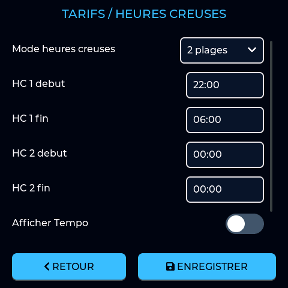
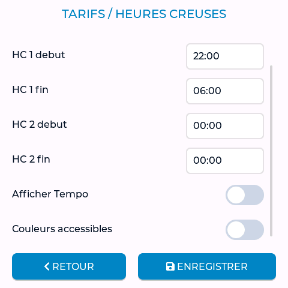

1. Choisir **2 plages** pour les horaires personnels ou **Tempo** selon le contrat.
2. Saisir les débuts et fins des heures creuses au format HH:MM. Faire défiler pour **Afficher Tempo** et **Couleurs accessibles**.
3. **ENREGISTRER**, puis vérifier le comportement et l’heure locale après redémarrage.

**À vérifier :** Ces horaires de l’écran sont distincts des six plages TOU du Deye. Les dates et couleurs d’exemple ne doivent pas être utilisées comme information tarifaire du jour.

<!-- pagebreak -->

## 18. Choisir la borne de recharge

**Chemin :** Réglages > Pilotage > Borne de recharge > Activation / tarifs.

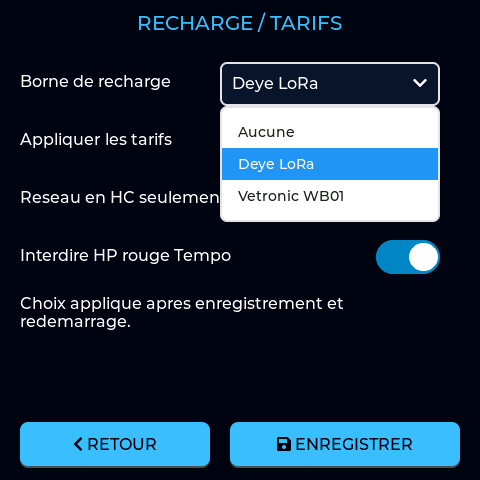
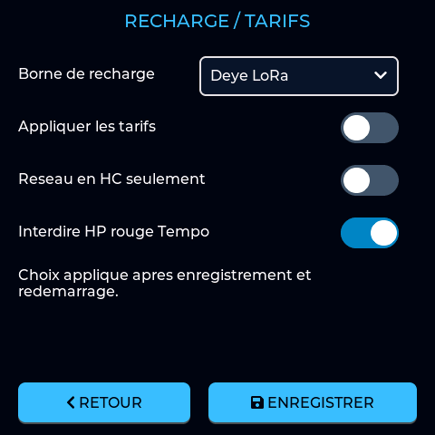

1. Sélectionner la borne réellement installée. **Aucune** conserve le suivi sans pilotage de recharge par l’écran.
2. Choisir les restrictions tarifaires souhaitées : réseau en HC seulement et interdiction des HP rouges Tempo, selon les options disponibles.
3. **ENREGISTRER**, laisser redémarrer puis ouvrir la page de la borne. Le choix de Deye LoRa dépend du profil compatible ; WB01 nécessite sa passerelle.

**À vérifier :** Changer de borne ou désactiver son utilisation dans l’écran n’arrête pas une charge en cours. Utiliser d’abord la commande d’arrêt si la charge doit être stoppée.

<!-- pagebreak -->

## 19. Utiliser la recharge Deye LoRa

**Chemin :** Réglages > Pilotage > Borne de recharge > Recharge Deye LoRa.

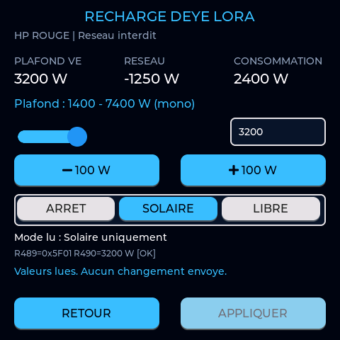

1. Vérifier que le modèle, les registres VE et la liaison correspondent au matériel pris en charge.
2. Lire le mode et la puissance affichés. Préparer la consigne avec les commandes proposées, puis utiliser l’action de validation de la page.
3. Après une demande, contrôler l’état relu et la borne elle-même. Une consigne affichée n’est pas une preuve que le véhicule charge.

**À vérifier :** Le profil historique Deye LoRa concerne le SUN-12K-SG02LP1-EU-AM2 ; ne pas sélectionner ce modèle sur un autre onduleur pour faire apparaître la fonction.

<!-- pagebreak -->

## 20. Relier et commander une Vetronic WB01

**Chemin :** Réglages > Pilotage > Borne de recharge > VE Tronic WB01.

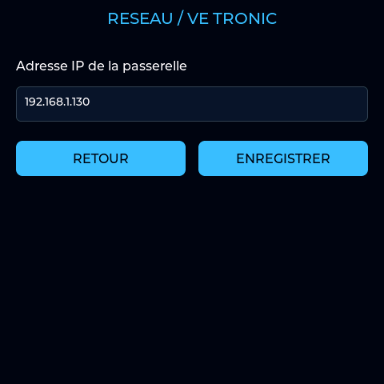
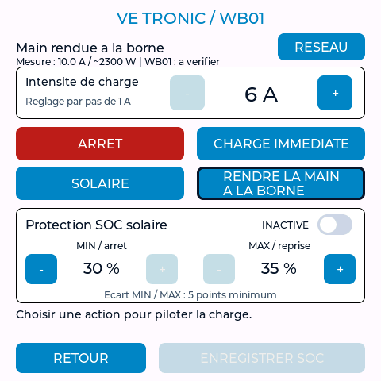

1. Saisir l’IP de la **passerelle ESP32 WB01** compatible avec le projet, puis enregistrer. Cette IP est distincte de celles du logger et de l’écran.
2. Vérifier la liaison, les mesures et les protections SOC. Choisir le mode voulu : arrêt, manuel, solaire ou rendre la main à la borne.
3. Après une commande, vérifier l’état retourné. **Rendre la main** laisse la borne suivre son propre fonctionnement.

**À vérifier :** La configuration Wi-Fi de la passerelle reste distincte de celle de Deye Monitor. Les intensités visibles sont des valeurs de démonstration.

<!-- pagebreak -->

## 21. Reconnaître une borne hors ligne

**Chemin :** Page de recharge WB01.

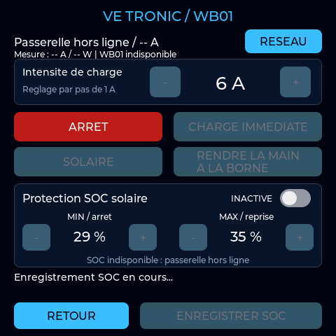
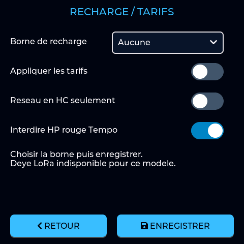

1. Face à des tirets, vérifier l’alimentation, le réseau et l’adresse de la passerelle.
2. Vérifier le choix de borne après une migration. L’absence de Deye LoRa sur un profil ne signifie pas que WB01 est indisponible.
3. Attendre le retour d’une mesure récente avant d’interpréter une ancienne valeur ou de conclure à la réussite d’une commande.

**À vérifier :** La perte de liaison de l’écran ne prouve pas l’arrêt physique de la borne. Contrôler son propre état si nécessaire.

<!-- pagebreak -->

## 22. Lire et modifier le Time of Use

**Chemin :** Réglages > Pilotage > Time of Use / batterie.

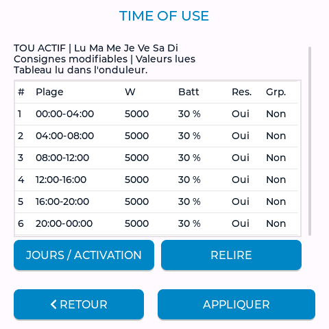
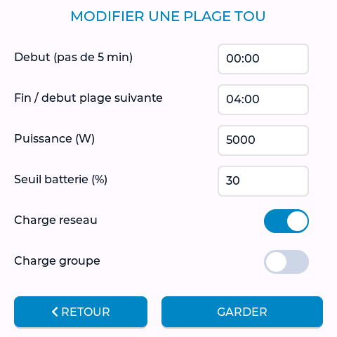

1. Lire les six lignes : début et fin, puissance, seuil batterie et autorisations de charge réseau/groupe.
2. Toucher une ligne pour préparer une modification. **GARDER** conserve un brouillon dans l’écran ; il ne commande pas encore le Deye.
3. Vérifier l’activation et les jours, examiner le tableau puis **APPLIQUER** et confirmer. Attendre la relecture de contrôle et comparer au LCD.

**À vérifier :** La fin d’une ligne est le début de la suivante ; la dernière boucle sur la première. Un échec partiel demande une comparaison de toutes les lignes avant une nouvelle tentative. Les profils non pris en charge restent indisponibles.

<!-- pagebreak -->

## 23. Confirmer les jours et le brouillon TOU

**Chemin :** Time of Use > Jours / activation, puis Appliquer.

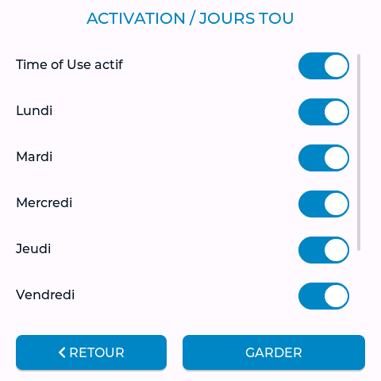
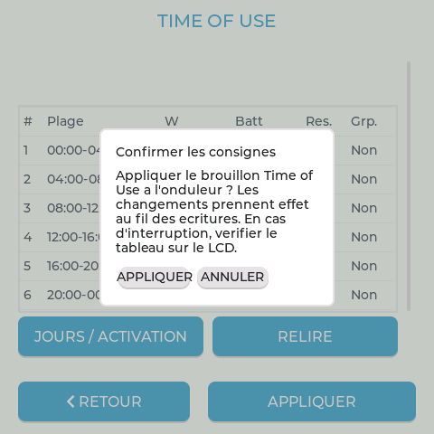

1. Choisir les jours et l’activation, puis **GARDER** pour revenir au tableau avec le brouillon.
2. Sur le tableau, relire les valeurs puis **APPLIQUER**. La confirmation envoie les modifications ; **ANNULER** quitte cette confirmation.
3. **RELIRE** remplace le brouillon par les valeurs de l’onduleur. Après application, contrôler la relecture et le LCD.

**À vérifier :** Les écritures successives prennent effet au fil des commandes. En cas d’interruption, vérifier toutes les lignes et les jours ; ne pas supposer un retour automatique à l’ancien tableau.

<!-- pagebreak -->

## 24. Préparer la batterie de la maison

**Chemin :** Réglages > Pilotage > Batterie / anticipation.

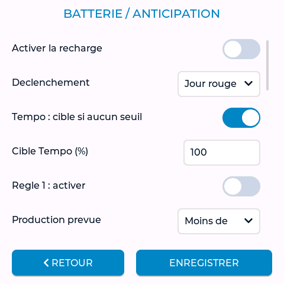
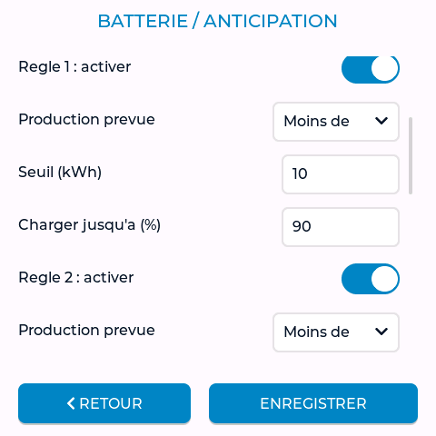

1. Laisser l’option désactivée pendant la préparation. Choisir **Jour rouge** pour Tempo ou **Prévision PV** pour les règles de prévision avec vos HC.
2. Faire défiler pour les trois règles : activation, **Moins de / Plus de**, seuil kWh et cible SOC. Contrôler ensuite **Si plusieurs règles**.
3. Sur le Web, **Exemple Tempo** remplit le brouillon sans activer ni enregistrer. Vérifier les valeurs et la priorité avant de sauvegarder ; l’enregistrement sur l’écran provoque son redémarrage.

**À vérifier :** Ce réglage concerne la batterie de la maison. Il exige un TOU compatible, actif, en mode SOC, une heure correcte et au moins une plage entièrement incluse dans les HC. Un cycle réel reste à valider.

<!-- pagebreak -->

## 25. Vérifier les trois seuils solaires

**Chemin :** Batterie / anticipation > faire défiler les règles.

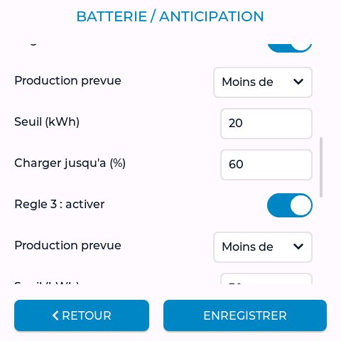
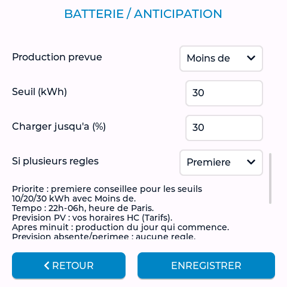

1. Chaque règle possède son interrupteur, son comparateur, son seuil et sa cible. Vérifier les quatre informations.
2. Pour cet exemple, activer les trois règles et choisir **Moins de** pour chacune ; conserver les seuils dans l’ordre 10, 20 et 30 kWh.
3. Faire encore défiler pour **Si plusieurs règles : Première**. La page suivante explique le résultat aux valeurs limites.

**À vérifier :** Les captures présentent un brouillon d’exemple, avec l’automatisme global encore désactivé. La cible d’une règle est un SOC souhaité ; elle ne demande pas une décharge forcée.

<!-- pagebreak -->

## 26. Utiliser l’exemple Tempo corrigé

**Chemin :** Web local > Pilotage > Time of Use · batterie, ou Batterie / anticipation sur l’écran.

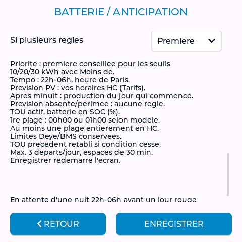

1. Règle 1 : **moins de 10 kWh → 90 %**. Règle 2 : **moins de 20 kWh → 60 %**. Règle 3 : **moins de 30 kWh → 30 %**.
2. Sélectionner la priorité **Première règle remplie**. Ainsi : 5 kWh → 90 %, 15 kWh → 60 %, 25 kWh → 30 %.
3. Les comparaisons sont strictes : exactement 10 kWh → 60 %, exactement 20 kWh → 30 %, à partir de 30 kWh → TOU habituel si le repli fixe reste décoché.

**À vérifier :** Les anciens réglages 4.8.9 conservent leur priorité et leurs signes. Pour remplacer l’ancien exemple, utiliser celui corrigé, vérifier puis sauvegarder. Une prévision requise indisponible bloque la nouvelle charge anticipée.

<!-- pagebreak -->

## 27. Régler le relais intégré

**Chemin :** Réglages > Pilotage > Relais.

1. Identifier la mesure à utiliser. Renseigner son registre, son caractère signé et son coefficient seulement s’ils sont connus.
2. Choisir le comparateur **<**, **=** ou **>**, le seuil et le délai. Lire la phrase récapitulative « ON si… ».
3. Activer la règle si le résultat convient, **ENREGISTRER**, puis vérifier la mesure relue et l’état réel de la sortie.

**À vérifier :** Le relais intégré est une sortie de l’écran ; il ne s’agit pas du port GEN du Deye. Une mesure indisponible entraîne l’état OFF prévu par la règle.

<!-- pagebreak -->

## 28. Connecter le Wi-Fi et ouvrir le Web

**Chemin :** Réglages > Réseau / Heure > Wi-Fi / Réseau.

1. Dans **WIFI / RÉSEAU**, toucher **SCAN**, choisir le Wi-Fi 2,4 GHz et saisir son mot de passe. **SAUVEGARDER**, puis attendre le redémarrage.
2. Revenir relever **IP Serveur Web / Écran**. Sur le téléphone connecté au même réseau, ouvrir http:// suivi de cette IP, ou l’accès Web proposé dans le menu.
3. Utiliser les identifiants habituels de l’écran si une protection est active. Le mot de passe vide d’un réseau déjà enregistré peut conserver celui mémorisé.

**À vérifier :** Si le téléphone annonce « sans Internet » sur un réseau local, conserver la connexion pour ouvrir la page de l’écran. Sans box, suivre le parcours réseau du guide de démarrage. Une illustration du formulaire Wi-Fi n’est pas disponible dans cette série de captures.

<!-- pagebreak -->

## 29. Régler la date, l’heure et le fuseau

**Chemin :** Réglages > Réseau / Heure > Date / Heure / Fuseau UTC.

1. Avec Internet, vérifier les serveurs NTP et le fuseau. Paris : **UTC+01:00 + Auto Europe** ; Antilles françaises : **UTC-04:00 + heure d’été désactivée**.
2. Sans synchronisation, ouvrir l’heure manuelle : date **AAAA-MM-JJ**, heure **HH:MM**, puis **APPLIQUER**.
3. Après une coupure d’alimentation sans NTP, vérifier à nouveau l’heure. Vérifier aussi l’horloge de l’onduleur pour le TOU.

**À vérifier :** La date de la capture est fictive. Changer le fuseau de l’écran ne change ni l’horloge ni les plages TOU de l’onduleur. La présentation du fuseau varie selon la version.

<!-- pagebreak -->

## 30. Choisir le thème et la veille

**Chemin :** Réglages > Écran.

1. Ouvrir **THÈME / LUMINOSITÉ**, choisir clair ou sombre et régler les niveaux jour/nuit selon votre besoin.
2. Ouvrir **VEILLE HORAIRE** : activer l’option, saisir début, fin et durée de réveil, puis **ENREGISTRER**.
3. Si l’écran devient noir à heure fixe, vérifier cette page. Un toucher le réveille temporairement pendant la durée prévue.

**À vérifier :** La veille coupe le rétroéclairage, tandis que les lectures et l’accès Web continuent. Une heure correcte est nécessaire.

<!-- pagebreak -->

## 31. Utiliser le clavier et les pages longues

**Chemin :** Dans un formulaire de réglages.

1. Toucher la case à modifier, saisir la valeur puis fermer ou valider le clavier.
2. Faire glisser le contenu vers le haut pour atteindre les champs du bas ; les boutons de retour et d’enregistrement restent à part.
3. Vérifier les valeurs avant **ENREGISTRER / SAUVEGARDER**. Le bouton du clavier ne remplace pas l’enregistrement de la page.

**À vérifier :** Si le clavier cache une information, le fermer avant de contrôler le formulaire. Ne pas recopier les IP et horaires des captures.

<!-- pagebreak -->

## 32. Sauvegarder et diagnostiquer

**Chemin :** Réglages > Système.

1. **SAUVEGARDE DES RÉGLAGES** ouvre l’accès local pour exporter le JSON. Garder une copie avant une mise à jour ou un changement important.
2. **DIAGNOSTIC / AIDE** permet de relever l’état des connexions et les lectures. Conserver le message précis, la version et la référence de l’onduleur.
3. **RÉGLAGES AVANCÉS** concerne les registres et coefficients. Ne les modifier qu’après identification de la cartographie et sauvegarde.

**À vérifier :** Un export peut contenir des informations privées : le transmettre uniquement à l’assistance concernée. Une réussite de connexion ne valide pas tous les registres ni toutes les commandes.

<!-- pagebreak -->

## 33. Mettre à jour le logiciel de l’écran

**Chemin :** Réglages > Système > Mise à jour.

1. Exporter les réglages. Vérifier le Wi-Fi, l’heure et l’alimentation, puis toucher **VÉRIFIER SUR GITHUB**.
2. Lire la version réellement proposée. Si elle convient, toucher **INSTALLER** puis confirmer. Un scintillement pendant l’installation est normal.
3. Attendre le redémarrage sans couper l’alimentation. Vérifier ensuite la version, le logger et les mesures. Une OTA compatible conserve les réglages.

**À vérifier :** Les versions et pourcentages de la capture sont fictifs. Le logiciel de l’écran ne met à jour ni l’onduleur ni le logger. Le lien [téléchargements](https://github.com/Chasticot/DEYE_LVGL_GUITION/releases/latest) reste celui des binaires publics.

<!-- pagebreak -->

## 34. Choisir le bon fichier et retrouver de l’aide

**Chemin :** Page Web locale > Mise à jour OTA.

1. Utiliser uniquement le fichier **_OTA.bin** adapté à l’écran et à son partitionnement. Ni ZIP, ni bootloader, ni partitions, ni image USB fusionnée dans ce formulaire.
2. Pour un écran vierge ou une récupération USB, utiliser le pack fourni pour ce matériel. Décompresser tout le ZIP avant INSTALLER.bat ; un effacement complet peut supprimer les réglages.
3. En cas de problème, relever la version, l’onduleur, le logger, le réseau et le message. Joindre des photos simultanées du LCD et de Deye Monitor pour une mesure incohérente.

**À vérifier :** Les guides ne constituent pas une annonce de disponibilité d’une version. Pour les détails : [FAQ](FAQ_ECRAN.md), [DL1000B](GUIDE_DL1000B_MODBUS_TCP.md), [prévision](GUIDE_PREVISION_SOLAIRE.md), [sources / microSD](GUIDE_MICRO_SD_SOFAR.md), [correction Tempo 4.8.10](NOTES_4.8.10.md).

