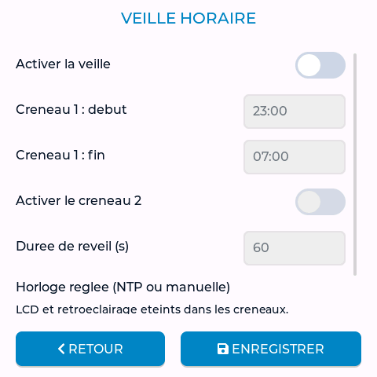
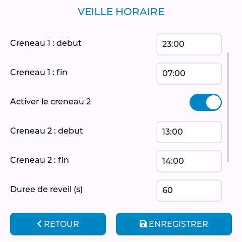

# Veille de l'écran — un ou deux créneaux — 4.9.2

Pendant les créneaux choisis, l'affichage LCD est désactivé et le rétroéclairage est éteint. **Le tactile reste actif pour réveiller l'écran.** Le rétroéclairage fonctionne uniquement allumé/éteint, à son niveau fixe ; aucun réglage de luminosité ni variation automatique n'est utilisé.

Les lectures de l'onduleur, les bornes, les automatismes et l'accès Web continuent pendant cette veille. Elle concerne l'affichage, sans mettre le processeur en sommeil profond.

## Régler les horaires

1. Ouvrir **Réglages → Écran → Veille horaire**.
2. Activer **Activer la veille**.
3. Renseigner **Créneau 1 : début** et **fin**, par exemple **23:00 → 07:00**.
4. Pour un second horaire, activer **Activer le créneau 2**, puis saisir ses heures, par exemple **13:00 → 14:00**. Laisser cette option désactivée pour conserver un seul créneau ; ses heures sont alors masquées sur l'écran.
5. Régler la **Durée de réveil (s)**, **60 secondes par défaut**, de 1 à 3 600 secondes.
6. Toucher **Enregistrer** et laisser l'écran redémarrer.

Les heures suivent l'heure locale de l'écran. Chaque créneau peut traverser minuit ; son heure de fin doit différer de son heure de début lorsqu'il est actif. Les créneaux peuvent se chevaucher ou se suivre : la veille continue tant qu'au moins l'un des deux s'applique.

Le même paramétrage existe dans la page Web, rubrique **Écran → Veille et réveil tactile**. Les réglages sont sauvegardés après redémarrage/OTA et inclus dans l'export/import de configuration. Un ancien réglage ou export à un seul créneau conserve ses horaires ; le deuxième reste désactivé.

Captures rendues depuis l’interface 4.9.2 avec des données simulées ; ne pas recopier les horaires sans les adapter.

## Réveiller l'écran

Pendant la veille, toucher normalement l'écran pour le rallumer temporairement. Le contact est filtré pour écarter les parasites. **Le toucher de réveil n'actionne aucun bouton** : relâcher le doigt, puis toucher la commande voulue.

Chaque nouveau contact confirmé prolonge le réveil. À l'expiration de la durée choisie, l'affichage et le rétroéclairage s'éteignent à nouveau si un créneau est encore actif. À la sortie du dernier créneau, l'écran reste allumé normalement.

Comme auparavant, une entrée dans un créneau, notamment après la première mise à l'heure, laisse aussi cette durée de réveil avant l'extinction. Cela laisse accès aux réglages au démarrage. Une opération OTA maintient l'affichage éveillé pendant son déroulement.

**Sans heure valide, l'écran reste allumé.** Vérifier **Réseau / heure → Heure / NTP** ou régler l'heure manuellement si nécessaire.

## Vérifications sur les écrans testeurs

Le logiciel a été compilé et testé avec des périphériques simulés. La coupure et le réveil doivent encore être vérifiés sur les différentes révisions matérielles :

- Observer une extinction réelle du rétroéclairage dans l'obscurité, après le délai de réveil.
- Vérifier un réveil tactile net, sans écran blanc persistant, sans variation de luminosité et sans action sur un bouton au premier toucher.
- Tester un créneau qui traverse minuit, puis deux créneaux distincts et leur sortie.
- Vérifier le retour en veille après le délai, la conservation des paramètres après redémarrage et l'accès Web pendant l'extinction.
