# Guide utilisateur — Deye Monitor

**Firmware unifié 4.7.2 — Édition du 26 octobre 2026.** [Manuel des fonctions communes (édition 4.6.3)](GUIDE_UTILISATEUR_V3.md) · [Récapitulatif](RECAP_UTILISATEURS_V3.md) · [PDF des fonctions communes (édition 4.6.3)](pdf/GUIDE_UTILISATEUR_V3.pdf).

Ce guide explique comment mettre en route et utiliser l’écran Deye Monitor au quotidien. Il concerne l’écran tactile, sa page accessible depuis un téléphone ou un ordinateur et les fonctions optionnelles de recharge.

**Si votre écran affiche déjà les bonnes mesures, vous pouvez l’utiliser directement. Il n’est pas nécessaire de le réinstaller.**

[Questions fréquentes et dépannage par symptôme](FAQ_ECRAN.md) · [Mémo de démarrage](RECAP_UTILISATEURS_V3.md).

## Commencer en images

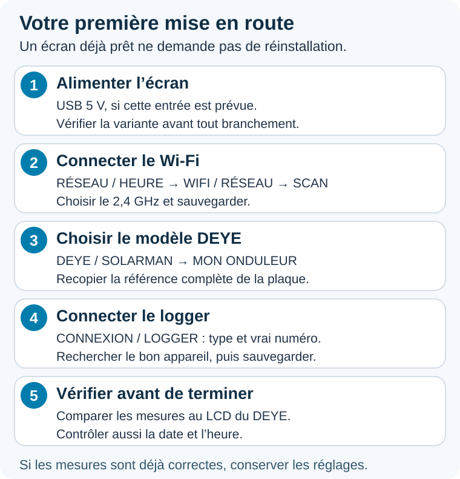

Suivre les étapes dans l’ordre. Chaque étape est détaillée ci-dessous ; les options de borne et de relais peuvent attendre.

**Comment lire les images :** les captures proviennent des aperçus créés pendant le développement. Leur thème, leurs libellés et leur version peuvent varier selon votre écran. Les IP, numéros, dates et mesures affichés sont des **exemples de démonstration à ne pas recopier**. Les schémas expliquent le principe et ne représentent pas les branchements électriques. Cliquer sur une image pour l’agrandir.

## Trouver rapidement une réponse

- [Vérifier la compatibilité](#vérifier-la-compatibilité-avant-de-commencer).
- [Alimentation et installation physique](#alimenter-et-installer-lécran).
- [Première utilisation : connecter l’écran](#première-utilisation--connecter-lécran).
- [Connexion directe au logger, sans box](#connexion-directe-au-logger-sans-box).
- [Faire apparaître les mesures de l’onduleur](#faire-apparaître-les-mesures-de-londuleur).
- [Comprendre le tableau de bord](#comprendre-le-tableau-de-bord).
- [Se repérer dans les menus](#se-repérer-dans-les-menus).
- [Configurer une borne de recharge](#configurer-une-borne-de-recharge).
- [Régler l’affichage et l’heure](#régler-laffichage-et-lheure).
- [Ouvrir l’écran sur un téléphone et sauvegarder ses réglages](#ouvrir-lécran-sur-un-téléphone-ou-un-ordinateur).
- [Mettre l’écran à jour](#mettre-lécran-à-jour).
- [Résoudre les problèmes courants](#résoudre-les-problèmes-courants).

## Vérifier la compatibilité avant de commencer

Préparer la **référence complète de l’onduleur**, la **référence du logger**, sa version si disponible et la version du logiciel de l’écran. Une photo de la plaque DEYE et du logger permet de lever les doutes. L’apparence d’une antenne ou d’une prise USB ne suffit pas à identifier toutes les variantes.

| Logger | Choix dans l’écran | État et points à vérifier |
| --- | --- | --- |
| LSW3 / LSW5 | LSW — Solarman V5 | Retours de fonctionnement avec ces familles. Vérifier le numéro du logger et l’accès local. |
| LSE, notamment LSE3 Ethernet | LSE — Ethernet Modbus TCP | Fonctionnement testé sur LSE3. Le logger peut être câblé à la box tandis que l’écran utilise le Wi-Fi du même réseau local. |
| DL1000B / DL1000B-WIFI, notamment les nouveaux modules USB | DL1000B — Modbus TCP | Mode logiciel prévu, mais compatibilité **à valider sur le logger réel**. Vérifier firmware, accès Modbus TCP activé et réponse locale avant de confirmer une installation. |

La présence de données dans DeyeCloud ou Solarman ne prouve pas que le logger autorise la lecture locale. La présence du DL1000B dans un menu n’est pas une validation matérielle de toutes ses versions. Si son interface propose **Link2 > Enable > Protocol : Modbus Tcp > Mode : Default**, faire vérifier ces paramètres pour ce matériel ; ne pas appliquer cette procédure à un autre logger.

Le catalogue couvre des familles DEYE, avec des fonctions et des états de validation différents. Relever tous les suffixes de la plaque : AM2, AM3, SM2, BM3, -P… Un profil disponible ne prouve pas que chaque fonction et chaque firmware d’onduleur ont été testés.

L’écran concerne le suivi d’un **onduleur hybride DEYE pris en charge**. Une installation constituée uniquement de micro-onduleurs, une batterie autonome ou une autre marque ne devient pas compatible parce qu’elle utilise aussi une application Solarman. Les sources APsystems/Shelly hors DEYE et les batteries externes non intégrées ne sont pas automatiquement récupérées. [Détails et limites](FAQ_ECRAN.md#compatibilité-et-fonctions).

## Alimenter et installer l’écran

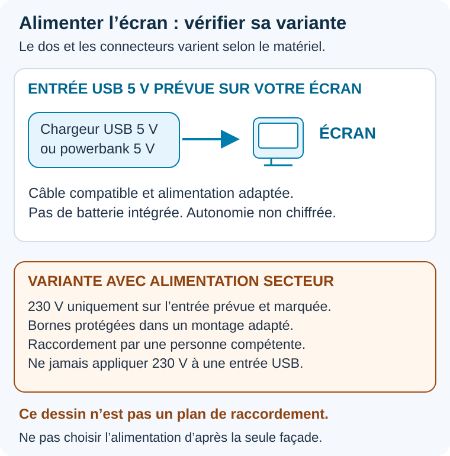

**Avant de brancher :** regarder le dos de votre écran et son marquage. Une façade identique ne garantit pas les mêmes entrées. Le schéma ne montre pas le câblage des bornes. Et la boîte doit être adaptée au dos de votre variante.

| Variante matérielle | Alimentation |
| --- | --- |
| Écran USB sans module secteur | Alimentation USB **5 V** adaptée, par exemple un chargeur de téléphone et un câble compatibles. |
| Variante équipée d’une alimentation secteur intégrée | USB-C **ou** entrée 230 V prévue par le fabricant, selon la version. Vérifier le matériel et son marquage avant raccordement. |

L’écran n’a pas de batterie intégrée. Une powerbank peut l’alimenter en USB 5 V, mais aucune autonomie chiffrée n’est garantie : elle dépend de la batterie, du Wi-Fi, de la luminosité et du câble. Le fonctionnement reste alimenté même quand le rétroéclairage est en veille.

Sur une version 230 V, les borniers arrière peuvent rester accessibles. Ils doivent être protégés dans un montage adapté ; l’écran ne doit pas être posé avec des bornes secteur accessibles. Faire réaliser le raccordement secteur par une personne compétente. Ne jamais appliquer 230 V à une entrée USB ou à une variante uniquement USB.

Pour l’encastrement, les boîtes rondes courantes ne conviennent pas nécessairement. Vérifier **largeur, hauteur, profondeur, fixation, place des fils et protection des bornes** sur la variante exacte avant d’acheter une boîte carrée ou un support. Les versions USB, un relais et trois relais n’ont pas forcément le même dos. Aucune cote universelle ni support imprimé 3D n’est validé ici. Ne pas forcer les clips du capot ; toute manipulation se fait appareil débranché. Le comportement thermique dans une boîte étanche n’a pas été caractérisé : ne pas présenter ce montage comme validé.

## Première utilisation : connecter l’écran

1. Allumer l’écran et ouvrir les paramètres avec le bouton de configuration.
2. Choisir **RÉSEAU / HEURE**, puis **WIFI / RÉSEAU**.
3. Toucher **SCAN**, choisir le réseau Wi-Fi de la maison et saisir son mot de passe.
4. Sauvegarder, puis laisser l’écran redémarrer si demandé.
5. Revenir dans la page Wi-Fi pour vérifier qu’une adresse IP est affichée. Cette adresse permet aussi d’ouvrir l’écran dans le navigateur d’un téléphone ou d’un ordinateur.

Utiliser un Wi-Fi **2,4 GHz**. Pour changer de réseau, refaire **SCAN**, sélectionner le nouveau nom, renseigner son mot de passe puis **SAUVEGARDER** ; attendre le redémarrage annoncé et vérifier le nom du réseau ainsi que l’IP obtenue.

L’écran et le module de communication de l’onduleur doivent pouvoir communiquer sur le **même réseau local**. Ils peuvent être sur des points d’accès différents, ou le logger en Ethernet, à condition que ce réseau permette les échanges entre eux. Un répéteur en mode routeur, un réseau invité ou l’isolation des clients peut empêcher la liaison, même si les deux appareils ont accès à Internet. Pour le premier essai, rapprocher l’écran du point d’accès et simplifier le réseau.

L’accès à Internet sert notamment à consulter les mises à jour, à synchroniser l’heure et aux informations Tempo. Les mesures de l’onduleur passent par le réseau local.

### Deux IP et deux numéros à ne pas confondre

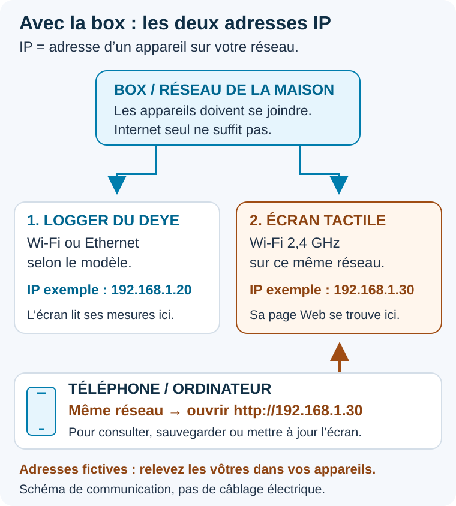

**À retenir :** dans CONNEXION / LOGGER, on renseigne l’adresse du logger. Dans le navigateur du téléphone, on ouvre l’adresse de l’écran. Les adresses dessinées sont fictives ; relever les vôtres.

| Information | Utilisation |
| --- | --- |
| Référence DEYE | Choix du modèle dans **MON ONDULEUR**. Ce n’est pas un numéro de série. |
| Numéro de série du logger | Identification du module dans **CONNEXION / LOGGER**. Ne pas utiliser le numéro de l’onduleur à sa place. |
| IP du logger | Adresse où l’écran lit les mesures. |
| IP de l’écran | Adresse à ouvrir sur le téléphone/PC pour la page Web, la sauvegarde et l’OTA. |

Les IP données dans cette notice sont des exemples. Sur le réseau de la maison, relever l’adresse **STA/LAN du logger** dans la box ou dans sa page locale, et non son adresse AP de configuration. Une réservation DHCP dans la box aide à garder une adresse stable.

## Connexion directe au logger, sans box

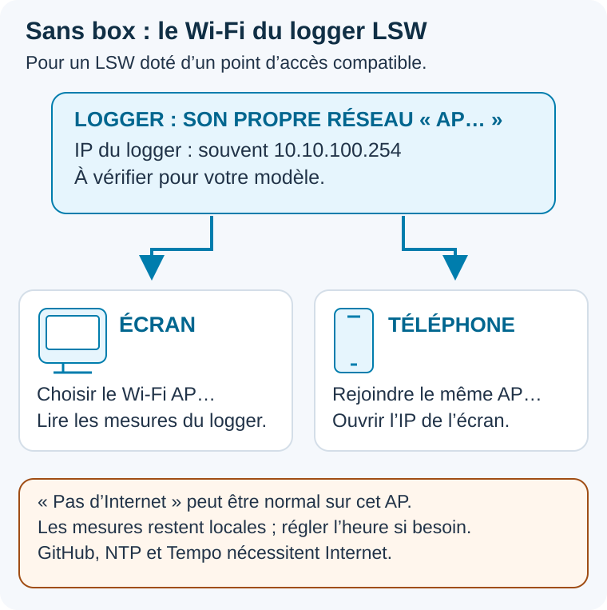

**AP** signifie ici que le logger crée son propre Wi-Fi. L’écran se connecte à ce Wi-Fi pour lire les mesures ; le téléphone le rejoint pour ouvrir la page de l’écran.

Ce mode a été utilisé avec un logger **LSW disposant de son propre point d’accès Wi-Fi**. Il ne constitue pas une validation de tous les LSE/DL1000B ou de toutes les variantes AP.

1. Près du logger, vérifier d’abord avec un téléphone qu’il est possible de rejoindre son réseau **AP…**, avec le mot de passe de son étiquette ou de sa notice.
2. Sur l’écran, ouvrir **RÉSEAU / HEURE > WIFI / RÉSEAU**, scanner, choisir ce même réseau AP et sauvegarder le mot de passe.
3. Choisir le modèle DEYE et le mode **LSW**. Renseigner le vrai numéro du logger.
4. Utiliser l’IP AP de ce logger. Sur les LSW concernés, l’adresse habituelle est **10.10.100.254** ; la vérifier dans sa notice ou sa page de configuration. Ne pas la recopier pour un autre matériel.
5. Vérifier la réception des mesures et régler manuellement la date et l’heure si Internet est absent.

Le réseau AP peut signaler « pas d’accès Internet » : cela n’empêche pas les mesures locales. Pour ouvrir la page Web de l’écran, le téléphone doit rejoindre ce même réseau AP et utiliser **l’IP de l’écran**, pas 10.10.100.254. Les mises à jour GitHub, NTP et Tempo nécessitent Internet. Pour mettre à jour, utiliser temporairement le réseau de la maison ou envoyer depuis un PC/téléphone le fichier OTA téléchargé auparavant, si la page Web locale reste joignable.

Il s’agit du même firmware que pour le réseau de la maison : aucun programme spécial « sans box » n’est nécessaire. Pour revenir à la box, reconnecter l’écran et le logger au réseau local voulu, puis vérifier de nouveau l’IP du logger. Pour une installation stable, privilégier le réseau de la maison quand sa couverture permet de joindre les deux appareils.

## Reconnexion automatique du Wi-Fi

Depuis la 4.6.3, après une perte du Wi-Fi, l'écran laisse cinq secondes à la reconnexion du pilote, puis relance une connexion avec les identifiants enregistrés. Si le routeur reste indisponible, il recommence toutes les 30 secondes, sans limite de durée. Au démarrage et après un scan manuel, la première tentative dispose de 30 secondes.

La **4.7.2** renforce la récupération après plusieurs tentatives infructueuses et détecte une liaison perdue malgré un ancien état « connecté ». Cette récupération ne demande pas Internet. Des retours de fonctionnement en direct au logger existent ; ils ne garantissent pas tous les scénarios de coupure, de reprise et toutes les variantes de logger.

Les paramètres DHCP ou IP fixe sont conservés et l'interface reste utilisable pendant l'attente. Un scan manuel suspend les relances, puis la connexion reprend à sa fin. Les lectures réseau reprennent par leurs tâches habituelles dès que le Wi-Fi revient. La récupération automatique d'une nouvelle adresse du logger reste limitée au mode LSW/V5.

## Faire apparaître les mesures de l’onduleur

### 1. Ouvrir le bon menu

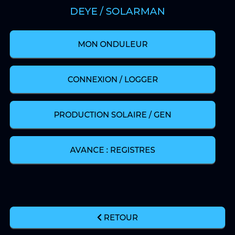

Toucher d’abord **MON ONDULEUR**, puis revenir ici pour **CONNEXION / LOGGER**. **PRODUCTION SOLAIRE / GEN** sert ensuite aux sources supplémentaires. Les registres avancés ne sont pas nécessaires pour démarrer.

### 2. Choisir la puissance et la référence

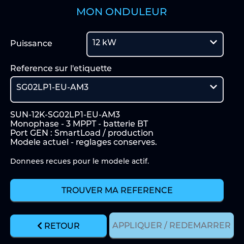

Lire la plaque de l’onduleur : choisir la **puissance** en haut, puis la **référence et ses suffixes**. Vérifier le récapitulatif avant d’appliquer. Le 12 kW illustré est un exemple, pas le choix à faire pour tous les écrans. Le bouton peut être grisé si le modèle choisi est déjà actif.

### 3. Renseigner la connexion au logger

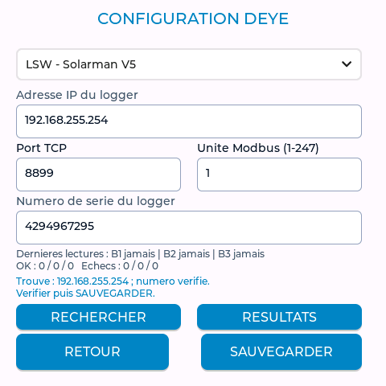

**Capture de démonstration : ne recopier ni l’IP 192.168.255.254 ni le numéro 4294967295.** Ils proviennent du simulateur ; le message « numéro vérifié » concerne cet exemple. Utiliser les informations de votre propre logger.

Sur cette page, lire de haut en bas :

1. **Type de logger** : choisir la famille du module réellement installé.
2. **Adresse IP du logger** : son adresse sur le réseau que vous utilisez.
3. **Port / unité** : conserver les valeurs adaptées à votre installation.
4. **Numéro de série du logger** : celui du module, pas celui du DEYE.
5. **RECHERCHER**, vérifier la réponse, puis **SAUVEGARDER**.

### Procédure complète

Le **logger** est le module de communication branché sur l’onduleur. Son numéro de série est celui à renseigner dans les réglages de connexion ; il peut être différent du numéro de série de l’onduleur lui-même.

1. Dans **DEYE / SOLARMAN > MON ONDULEUR**, choisir la puissance et la référence exacte, puis **APPLIQUER / REDÉMARRER** et confirmer.
2. Ouvrir **DEYE / SOLARMAN > CONNEXION / LOGGER**.
3. Choisir le type de module : **LSW**, **LSE** ou **DL1000B**, selon l’équipement installé.
4. Renseigner le vrai numéro du logger. Les lettres sont acceptées pour le DL1000B.
5. Toucher **RECHERCHER**. La recherche peut prendre plusieurs minutes ; les mesures peuvent être momentanément suspendues.
6. Vérifier l’adresse trouvée, puis sauvegarder.

Si le résultat indique **numéro non vérifié**, ouvrir **RESULTATS** et choisir explicitement le bon module avant de sauvegarder. Une réponse sur le réseau ne suffit pas toujours à identifier son numéro.

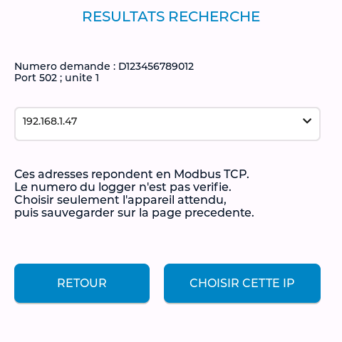

**Cas particulier illustré : une réponse Modbus TCP ne vérifie pas le numéro.** Identifier l’équipement avant de toucher **CHOISIR CETTE IP**, revenir à la page précédente et sauvegarder. Cet aperçu ne prouve pas la compatibilité d’un DL1000B réel.

Si vous connaissez déjà l’adresse IP du logger, vous pouvez la saisir directement. Les ports proposés sont **8899 pour LSW**, **8899 pour LSE** et **502 pour DL1000B** ; conserver un port différent si votre équipement a été configuré ainsi. L’unité doit correspondre à l’adresse de communication configurée sur l’onduleur. Si ces informations ne sont pas connues, les demander à l’installateur.

Après redémarrage, attendre l’arrivée des mesures et les comparer à celles de l’afficheur de l’onduleur. Une erreur de modèle ou de connexion doit être corrigée avant d’interpréter les valeurs.

Avec un logger **LSW / Solarman V5** dont le vrai numéro est enregistré, l’écran peut retrouver automatiquement son adresse IP après une perte durable de connexion. Pour une connexion TCP, vérifier l’adresse et les paramètres dans ce menu si la liaison est perdue.

## Choisir le modèle et les sources de production

Choisir **DEYE / SOLARMAN > MON ONDULEUR**, puis la **puissance** et la **référence exacte** de l’étiquette, suffixes compris. Vérifier le récapitulatif, toucher **APPLIQUER / REDÉMARRER** et confirmer. Le Web propose aussi une recherche par fragments.

Le catalogue et les références sélectionnables dépendent de la version installée. Les profils expérimentaux sont signalés à confirmer et certaines anciennes références peuvent n’être conservées que pour reprendre leurs sauvegardes. Les voies PV, le nombre de MPPT et les fonctions proposées suivent le modèle choisi. Les réglages existants par référence sont conservés. Les SG06 expérimentaux et les fonctions non vérifiées restent signalés à confirmer. Comparer les mesures au LCD de l’onduleur.

Dans **DEYE / SOLARMAN > PRODUCTION SOLAIRE / GEN**, choisir **Automatique**, **Port non utilisé**, **Appareils pilotés (SmartLoad)**, **Production solaire supplémentaire** ou **Groupe électrogène**. Le mode automatique lit le réglage de l’onduleur ; une réponse absente ou périmée reste « à préciser ». Ces choix adaptent l’écran sans changer le mode de l’onduleur.

La production solaire supplémentaire peut être cumulée avec PV si son énergie n’est pas déjà incluse dans PV Daily. Le groupe électrogène n’est jamais ajouté au solaire. Les fonctions et voies absentes sont masquées. Le choix de borne reste explicite.

Si la référence exacte manque, vérifier la version de l’écran et la dernière mise à jour. Ne pas choisir au hasard un modèle de même puissance : monophasé, triphasé et haute tension n’ont pas forcément les mêmes registres. Faire confirmer un profil de remplacement avant de modifier des coefficients ou d’activer une commande.

Pour des micro-onduleurs **raccordés au port GEN du DEYE**, sélectionner **Production solaire supplémentaire** (ou **GEN MO** sur une ancienne version), puis l’option de cumul GEN + PV si souhaitée. **Sauvegarder** et vérifier après redémarrage. Cela adapte l’affichage, sans reconfigurer physiquement le port de l’onduleur. Une production raccordée ailleurs n’est pas automatiquement une mesure GEN. Ne pas détourner une ligne PV pour afficher GEN quand l’option prévue est disponible.

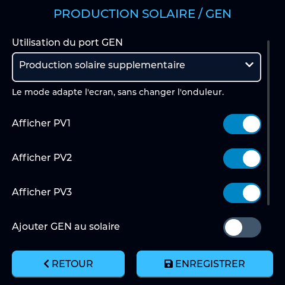

Pour des micro-onduleurs **déjà raccordés au port GEN du DEYE**, choisir **Production solaire supplémentaire**. Activer **Ajouter GEN au solaire** seulement si le cumul est souhaité, puis **ENREGISTRER**. Dans cette capture, le cumul est désactivé. Ne pas l’activer pour un groupe électrogène.

Le total instantané en W et le total journalier en kWh sont deux réglages/mesures distincts. Éviter de compter GEN deux fois si le compteur solaire du DEYE l’inclut déjà. Un préfixe **~** signale une énergie estimée par l’écran. L’absence d’un compteur GEN valide ne signifie pas une production nulle.

[Notes historiques 4.7.0](GUIDE_UNIFIE_4.7.0.md) · [FAQ GEN, coefficients et valeurs incohérentes](FAQ_ECRAN.md#mesures-et-production).

## Comprendre le tableau de bord

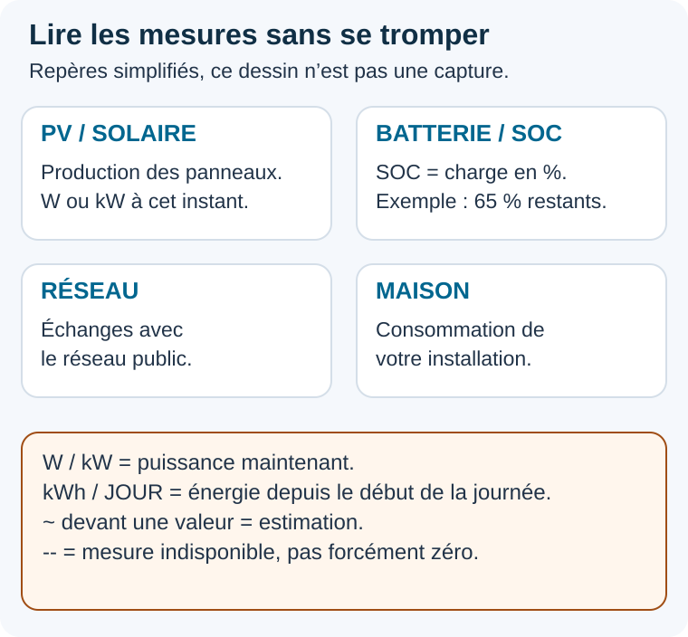

**Exemple simple :** 1 000 W pendant une heure correspondent à 1 kWh. Une puissance instantanée et un cumul du jour ne se comparent donc pas directement. La disposition réelle et les rubriques visibles dépendent du modèle.

| Indication | Ce qu’elle signifie |
| --- | --- |
| **PV / solaire** | Production des panneaux solaires. |
| **Batterie / SOC** | Niveau de charge de la batterie, exprimé en pourcentage. Les autres valeurs indiquent son fonctionnement. |
| **Réseau** | Échanges d’électricité avec le réseau public. |
| **Maison / consommation** | Électricité utilisée par l’installation. |
| **W ou kW** | Puissance à cet instant. 1 kW correspond à 1 000 W. |
| **kWh / JOUR** | Quantité d’énergie cumulée sur la journée. |
| **GEN / SMARTLOAD** | Entrée ou sortie supplémentaire selon le modèle et les réglages de l’installation. |
| **Voiture** | État de la recharge lorsque cette fonction a été configurée. |

Un tiret ou une indication indisponible signifie que l’écran ne dispose pas d’une mesure exploitable. Cela ne signifie pas forcément zéro.

Certaines informations dépendent du modèle d’onduleur, des équipements présents et de leur communication. Les compteurs journaliers dépendent aussi d’une heure correcte.

## Se repérer dans les menus

Le menu **CONFIGURATION** regroupe les réglages :

| Menu | Utilisation |
| --- | --- |
| **DEYE / SOLARMAN** | Choisir l’onduleur, connecter son logger et régler les sources de production. |
| **TARIFS / HEURES CREUSES** | Configurer les informations tarifaires utilisées par les fonctions prévues. |
| **VÉHICULE ÉLECTRIQUE** | Choisir la borne et accéder à sa page de recharge. |
| **RELAIS** | Configurer la règle du relais de l’écran, si cette fonction est utilisée. |
| **RÉSEAU / HEURE** | Connexion Wi-Fi, fuseau et réglage de l’heure. |
| **AFFICHAGE** | Thème, luminosité et veille horaire. |
| **MISE À JOUR** | Chercher et installer une nouvelle version ; ouvrir ce guide avec le QR code. |

**RETOUR** quitte la page. **SAUVEGARDER**, **ENREGISTRER** ou **APPLIQUER** valide les modifications selon la page. Laisser le redémarrage se terminer lorsqu’il est annoncé.

Les menus de registres et de coefficients servent à adapter les mesures à un matériel particulier. Pour une utilisation courante, conserver les valeurs prévues pour le modèle choisi ; les modifier avec les informations de l’installateur si nécessaire.

## Configurer une borne de recharge

Si vous n’utilisez pas la fonction de recharge de l’écran, choisir **Aucune**.

Sinon, ouvrir **VÉHICULE ÉLECTRIQUE > ACTIVATION / TARIFS**, sélectionner le système utilisé et enregistrer :

| Choix | Équipement concerné |
| --- | --- |
| **Aucune** | Utilisation du suivi Deye sans pilotage d’une borne par l’écran. |
| **Deye LoRa** | Système compatible avec le profil explicitement pris en charge par le firmware, après validation de la liaison et déverrouillage des écritures. Ne pas changer de modèle au hasard pour activer cette fonction. |
| **Vetronic WB01** | Borne WB01 accompagnée de la passerelle ESP32 compatible avec ce projet. |

Après le redémarrage, ouvrir la page de la borne. Pour une WB01, renseigner l’adresse IP de sa passerelle. La configuration de cette passerelle reste distincte de celle de l’écran.

Les modes disponibles dépendent du système choisi. Ils permettent notamment d’arrêter la charge, de demander une charge immédiate ou d’utiliser le solaire. Avec WB01, **Rendre la main à la borne** permet de la laisser fonctionner de façon autonome.

Changer le choix de borne ou désactiver son utilisation dans l’écran n’arrête pas une charge déjà en cours. Pour arrêter une charge, utiliser d’abord sa commande d’arrêt.

Les horaires et tarifs doivent être vérifiés dans les réglages. Ils ne prennent pas automatiquement le contrôle de toutes les charges lancées depuis un autre appareil.

## Régler l’affichage et l’heure

Dans **AFFICHAGE > THÈME / LUMINOSITÉ**, choisir le thème clair ou sombre et les niveaux de luminosité souhaités.

Dans **AFFICHAGE > VEILLE HORAIRE**, régler les plages de veille si vous souhaitez que l’écran s’éteigne à certaines heures. Un toucher permet de le réveiller temporairement selon le délai configuré.

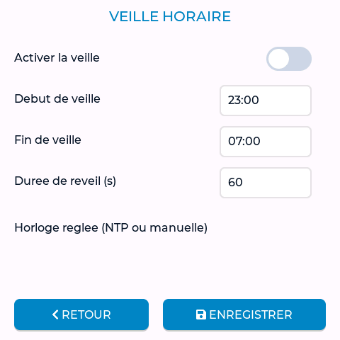

**Écran noir à heure fixe ?** Vérifier cette page. L’interrupteur en haut active la veille ; choisir les horaires et la durée du réveil au toucher, puis **ENREGISTRER**. La veille coupe le rétroéclairage, pas les lectures ni la page Web. Les horaires montrés sont des exemples.

Dans **RÉSEAU / HEURE > HEURE / NTP**, vérifier le fuseau et la synchronisation. Pour la France métropolitaine, utiliser **Europe/Paris**.

Sans synchronisation Internet, choisir **RÉGLER L’HEURE MANUELLEMENT**, saisir la date et l’heure locales, puis appliquer. Après une coupure d’alimentation, régler de nouveau l’heure si elle ne peut pas se synchroniser automatiquement.

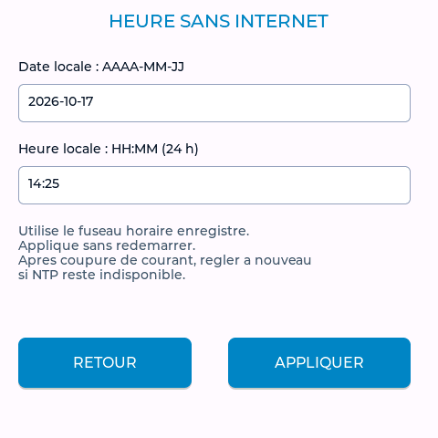

**Sans Internet :** entrer la date du jour et l’heure locale dans les deux cases, puis **APPLIQUER**. La date et l’heure de la capture sont fictives. Après une coupure, vérifier de nouveau si la synchronisation reste indisponible.

## Ouvrir l’écran sur un téléphone ou un ordinateur

1. Connecter le téléphone ou l’ordinateur au réseau de la maison.
2. Relever l’adresse IP de l’écran dans sa page Wi-Fi.
3. Saisir cette adresse dans la barre d’adresse du navigateur, par exemple `http://192.168.1.50` en remplaçant l’exemple par l’adresse réelle.
4. Si une identification est demandée, utiliser le compte configuré pour l’écran.

La page web donne accès à la configuration, au tableau de bord et aux outils de diagnostic.

Pour conserver une copie des réglages, utiliser l’**export de configuration JSON** et garder le fichier sur le téléphone ou l’ordinateur. Il est conseillé d’en faire une copie avant une mise à jour ou un changement important de réglages. Le fichier d’import doit correspondre à la configuration et au modèle utilisés.

## Mettre l’écran à jour

La dernière version stable vérifiée le **26/10/2026** est **4.7.2**. Pour les téléchargements futurs, consulter la [dernière release stable](https://github.com/Chasticot/DEYE_LVGL_GUITION/releases/latest). Une mise à jour du logiciel **de l’écran** ne met pas à jour l’onduleur ni le logger.

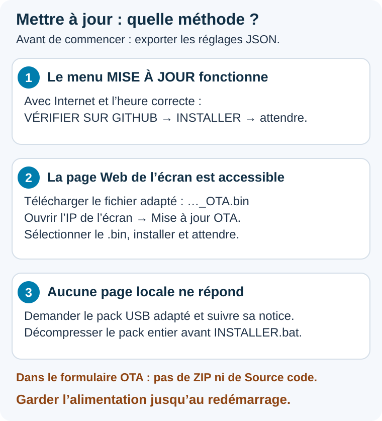

Utiliser la première méthode disponible. Un écran qui fonctionne ne demande pas une réinstallation USB. **OTA** signifie ici une mise à jour par le réseau.

### Depuis le menu tactile

Sur un écran qui possède le menu **MISE À JOUR** :

1. Vérifier que le Wi-Fi et l’heure sont corrects.
2. Ouvrir **CONFIGURATION > MISE À JOUR**.
3. Toucher **VÉRIFIER SUR GITHUB**.
4. Si une nouvelle version est proposée, toucher **INSTALLER**, puis confirmer.
5. Attendre la fin de l’installation et le redémarrage.

**L’écran va scintiller pendant l’installation. C’est normal. Ne coupez pas l’alimentation jusqu’au redémarrage.**

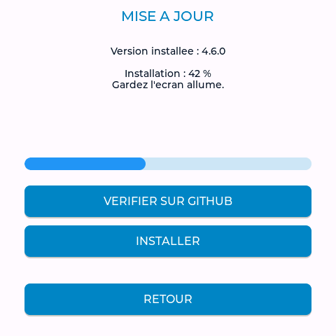

Sur cette ancienne capture de développement, **4.6.0** et **42 %** sont des exemples. Sur votre écran, lire la version réellement proposée ; la référence publique vérifiée pour cette notice est **4.7.2**. Une fois l’installation lancée, laisser l’alimentation jusqu’au redémarrage.

Une mise à jour compatible conserve les réglages. Si l’écran indique qu’il est à jour, aucune installation supplémentaire n’est nécessaire. Si une erreur apparaît, lire le message et réessayer après avoir corrigé la connexion ou l’heure.

### Depuis un téléphone ou un ordinateur

1. Télécharger **DEYE_V3_4.7.2_OTA.bin** depuis la [release 4.7.2](https://github.com/Chasticot/DEYE_LVGL_GUITION/releases/tag/v4.7.2), ou le fichier **_OTA.bin** adapté de la dernière version stable.
2. Relever l’IP **de l’écran** dans sa page Wi-Fi et ouvrir cette IP en **http://** depuis le même réseau.
3. Dans le formulaire **Mise à jour OTA**, choisir le fichier .bin, puis lancer l’installation.
4. Attendre le redémarrage sans couper l’alimentation ; vérifier la version et les mesures.

Ne pas envoyer le ZIP, les archives GitHub **Source code**, un bootloader, un fichier de partitions ou une image USB fusionnée dans le formulaire OTA. Le fichier doit correspondre à l’écran et à son partitionnement. La 4.7.2 est fournie avec **SHA256SUMS-4.7.2.txt** pour le contrôle de l’empreinte.

### Si l’écran n’est plus joignable : récupération USB

Si le Wi-Fi fonctionne encore sur le réseau AP du logger, la page Web locale peut permettre une mise à jour même sans Internet. Si aucune page locale n’est accessible, une réinstallation USB peut être nécessaire.

Demander le **pack Windows adapté à la version et au matériel**, utiliser un câble USB de données et suivre sa notice. Lorsque ce pack contient **INSTALLER.bat**, décompresser **tout le ZIP** avant de lancer ce fichier avec l’écran raccordé. Ne pas exécuter l’installateur depuis l’archive compressée.

L’option **nouvel écran / installation complète** peut remplacer des réglages : ne pas la choisir systématiquement pour résoudre un problème Wi-Fi. Elle a été utilisée dans un dépannage précis, pas comme procédure générale. Sauvegarder avant si possible et suivre les consignes d’assistance pour l’écran concerné. Le dépôt public ne distribue pas de code source à compiler et ses archives automatiques ne sont pas ce pack USB.

## Résoudre les problèmes courants

| Problème | Vérification à faire |
| --- | --- |
| L’écran ne se connecte pas au Wi-Fi | Vérifier le réseau choisi, le mot de passe et la portée du Wi-Fi. |
| Le Wi-Fi fonctionne, mais les mesures ne s’affichent pas | Vérifier le type de logger, son adresse IP, son numéro, son port et le modèle d’onduleur. |
| La recherche ne trouve pas le logger | Vérifier qu’il est allumé et joignable sur le même réseau ; saisir son IP connue si nécessaire. |
| Plusieurs adresses sont proposées | Choisir le bon équipement dans **RESULTATS** avant de sauvegarder. |
| Une mesure affiche un tiret | Vérifier la liaison et la présence de cette mesure sur le modèle utilisé. |
| Le solaire affiche zéro la nuit | C’est normal en l’absence de production des panneaux. |
| L’heure ou les compteurs du jour sont incohérents | Vérifier le fuseau, la date et l’heure. |
| L’écran est noir à certaines heures | Vérifier la veille horaire et toucher l’écran pour le réveiller. |
| La page web ne s’ouvre pas | Vérifier l’IP actuelle de l’écran et la connexion du téléphone au réseau de la maison. |
| La mise à jour échoue | Vérifier l’accès Internet et l’heure, puis réessayer avec une alimentation stable. |
| La borne n’apparaît pas ou ne répond pas | Vérifier son choix dans **ACTIVATION / TARIFS** et, pour WB01, l’IP de sa passerelle. |

Si le problème persiste, noter le modèle d’onduleur, le type de logger, la version du firmware, le message affiché et les réglages de connexion. Ces informations aideront la personne qui accompagne votre installation.

## Demander de l’aide sans multiplier les échanges

Envoyer, en une fois et de préférence en privé :

- la référence complète de l’onduleur et une photo lisible de sa plaque ;
- le modèle exact du logger, son firmware si disponible et une photo de son étiquette ;
- la version de Deye Monitor et le type de logger choisi dans l’écran ;
- le mode de connexion : réseau de la maison, Ethernet, répéteur/mesh ou AP du logger ;
- le symptôme précis, le message affiché, depuis quand il apparaît et ce qui a changé ;
- pour une mesure fausse, une photo de l’écran et du LCD DEYE prises au même moment ;
- si demandé, les résultats de **Vérifier les lectures**, le diagnostic et l’export JSON.

Masquer les mots de passe Wi-Fi/logger, QR codes d’accès, identifiants privés et numéros d’appareil avant une publication publique. Ne pas joindre une adresse d’expédition ou une preuve de paiement à une question technique publique. Un test sur simulateur, une connexion ponctuelle et un retour de plusieurs heures ne valident pas toutes les fonctions d’un matériel.

## Liens utiles

- [Dernière version et téléchargements](https://github.com/Chasticot/DEYE_LVGL_GUITION/releases/latest).
- Mise à jour depuis le menu de l’écran ou sa page Web OTA.
- [Questions fréquentes](FAQ_ECRAN.md).
- [Mémo de démarrage](RECAP_UTILISATEURS_V3.md).
- [Notes historiques de la version 4.7.0](GUIDE_UNIFIE_4.7.0.md).
- [Projet Deye Monitor sur GitHub](https://github.com/Chasticot/DEYE_LVGL_GUITION).

