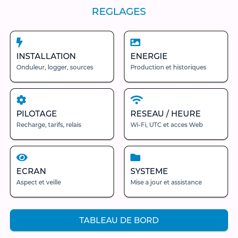
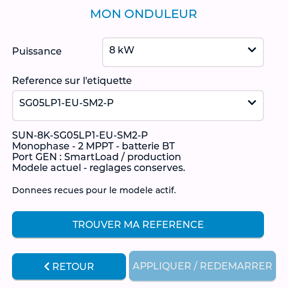
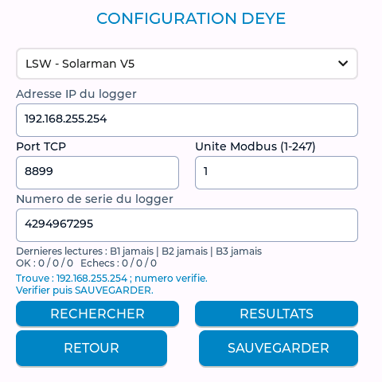
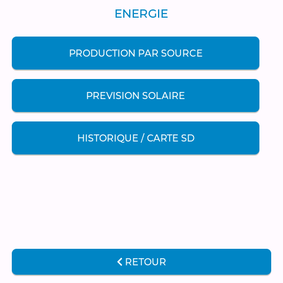
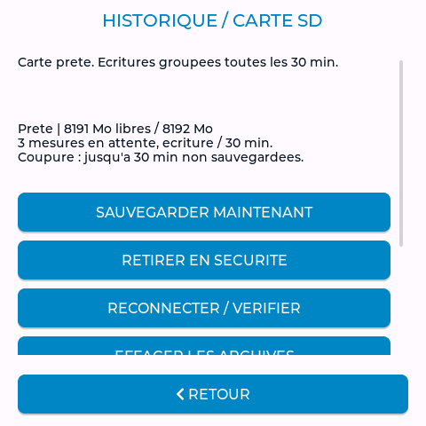
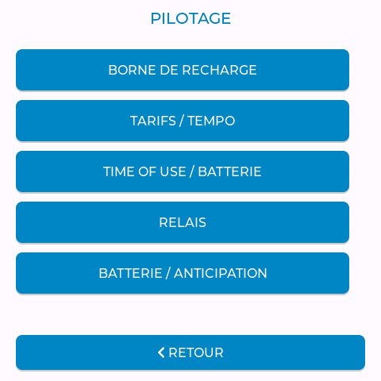
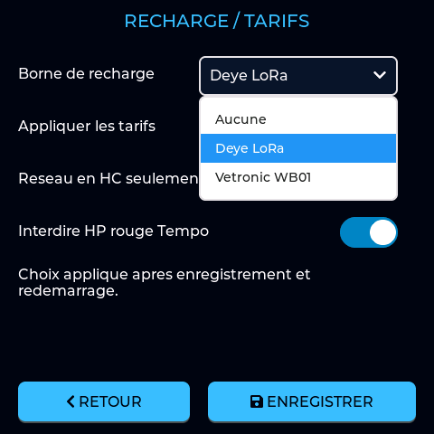
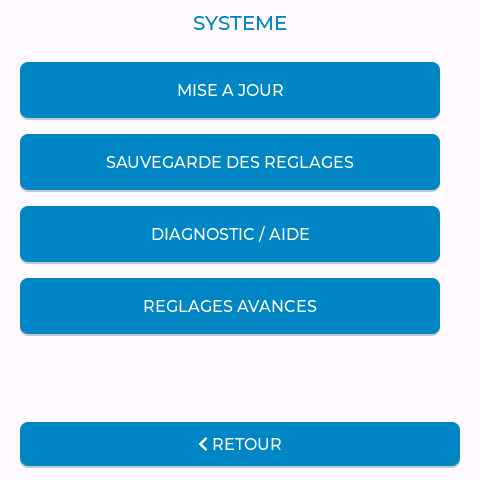

# Deye Monitor - Mémo de démarrage

**Édition du 6 novembre 2026 - Menus de référence 4.8.10.**

[Guide illustré complet](GUIDE_UTILISATEUR_V3.md) · [Guide PDF](pdf/GUIDE_UTILISATEUR_V3.pdf) · [Mémo PDF](pdf/RECAP_UTILISATEURS_V3.pdf).

Si l’écran affiche déjà les bonnes mesures, l’utiliser directement. Une mise à jour n’impose pas une réinstallation USB.

## 1. Retrouver les menus

**Installation** relie l’onduleur et les sources. **Énergie** affiche production, prévision et historique. **Pilotage** regroupe borne, tarifs, batterie et relais. **Réseau / Heure**, **Écran** et **Système** regroupent les réglages de l’appareil.

Les captures sont issues du simulateur de l’interface : valeurs, adresses et références d’exemple. Ne pas les recopier. La présentation varie selon la version installée. Les anciennes rubriques DEYE / SOLARMAN et AFFICHAGE ont été réorganisées dans les menus récents.

<!-- pagebreak -->

## 2. Obtenir les premières mesures

1. **Réseau / Heure > Wi-Fi / Réseau** : SCAN, choisir le Wi-Fi 2,4 GHz, saisir son mot de passe et sauvegarder. Attendre le redémarrage.
2. **Installation > Mon onduleur** : puissance, référence complète et suffixes ; appliquer et laisser redémarrer.
3. **Installation > Connexion / logger** : type, IP locale, vrai numéro, port et unité. Rechercher, vérifier puis sauvegarder.
4. Comparer SOC, tension et puissances au LCD du Deye. Régler la date et le fuseau avant d’utiliser les horaires.

**IP du logger = mesures. IP de l’écran = page Web, sauvegarde et OTA.** Ports proposés : LSW 8899, LSE 8899, DL1000B 502. Le numéro est celui du logger, pas de l’onduleur.

Pour DL1000B, suivre le [guide d’activation Modbus TCP](GUIDE_DL1000B_MODBUS_TCP.md). Si le numéro n’est pas vérifié, identifier l’appareil dans RESULTATS avant de choisir son IP.

<!-- pagebreak -->

## 3. Solaire, historique et microSD

1. Pour une passerelle supplémentaire : **Installation > Sources solaires / PV5 à PV8**, puis ouvrir le QR code sur le même réseau. Tester en **Afficher séparément** avant de choisir l’ajout au total.
2. Si GEN mesure déjà cette production, choisir **Déjà mesurée par le port GEN**. Ne pas ajouter deux fois les mêmes watts et kWh.
3. **Énergie > Prévision solaire** : régler position, panneaux et orientation. Une prévision est une estimation ; les mesures réelles restent distinctes.

Depuis 4.8.9, les mesures microSD sont regroupées avant écriture, environ toutes les trente minutes. **Sauvegarder maintenant** avant une coupure prévue ; **Retirer en sécurité**, attendre la confirmation, puis retirer la carte. Après insertion, reconnecter/vérifier.

**Formater la carte efface tous ses fichiers.** Télécharger les archives utiles d’abord. Sans carte, les dernières 24 h restent en mémoire vive. Les essais physiques de formatage restent à valider pour cette préparation.

<!-- pagebreak -->

## 4. Recharge de la voiture et batterie de la maison

1. **Pilotage > Borne de recharge > Activation / tarifs** : choisir le matériel, enregistrer et attendre le redémarrage. Pour WB01, renseigner ensuite l’IP de sa passerelle.
2. Les horaires de **Tarifs / Tempo** sont distincts des six plages **Time of Use** de l’onduleur.
3. **Batterie / anticipation** concerne la batterie de la maison. L’option est désactivée par défaut ; vérifier TOU, SOC, heure et plages HC avant activation.

**Exemple corrigé 4.8.10 :** moins de 10 kWh → 90 %, moins de 20 kWh → 60 %, moins de 30 kWh → 30 %, avec priorité à la **première règle remplie**. À 10 kWh exactement, la cible est 60 % ; à 20 kWh, 30 %. Sans règle correspondante et sans repli fixe, le TOU habituel est conservé.

Le bouton Web **Exemple Tempo** remplit seulement le brouillon. Les anciens réglages restent conservés ; vérifier puis sauvegarder pour les remplacer. Un cycle réel reste à valider. Changer le choix de borne n’arrête pas une voiture déjà en charge.

<!-- pagebreak -->

## 5. Heure, veille, sauvegarde et mise à jour

1. **Réseau / Heure** : Paris = UTC+01:00 + Auto Europe ; Antilles françaises = UTC-04:00, sans heure d’été. Sans NTP, saisir la date et l’heure manuellement ; les vérifier après une coupure.
2. **Écran > Veille horaire** : si l’écran est noir à heure fixe, toucher pour le réveiller puis contrôler les horaires. Les lectures et le Web continuent pendant la veille.
3. **Système > Sauvegarde des réglages** : exporter le JSON avant une modification importante. **Mise à jour > Vérifier sur GitHub > Installer**, puis confirmer et attendre le redémarrage.

Par le Web, envoyer seulement le fichier **_OTA.bin** adapté à l’écran. Ni ZIP, ni bootloader, ni image USB fusionnée. Le scintillement pendant l’installation est normal ; garder l’alimentation jusqu’au redémarrage. Une OTA compatible conserve les réglages.

Si la page Web ne s’ouvre pas, vérifier l’IP actuelle de l’écran et le réseau du téléphone. Si les mesures manquent, contrôler logger, IP, numéro, port/unité et modèle. Une récupération USB demande le pack adapté au matériel.

Pour l’assistance : version de l’écran, référence d’onduleur, logger, réseau et message précis. Pour une mesure incohérente, photos de Deye Monitor et du LCD prises au même instant. Garder mots de passe et exports privés.

[FAQ et dépannage](FAQ_ECRAN.md) · [Sources et historique](GUIDE_MICRO_SD_SOFAR.md) · [Prévision solaire](GUIDE_PREVISION_SOLAIRE.md) · [Notes 4.8.10](NOTES_4.8.10.md).
